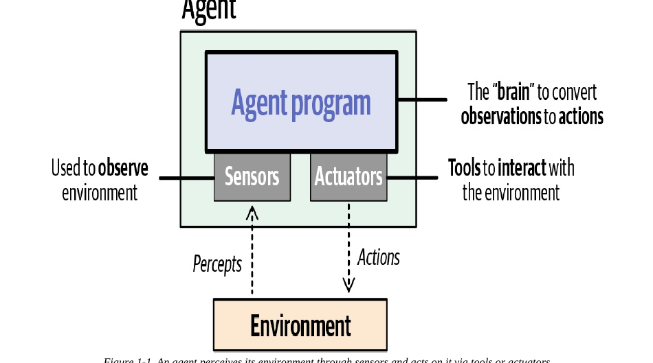
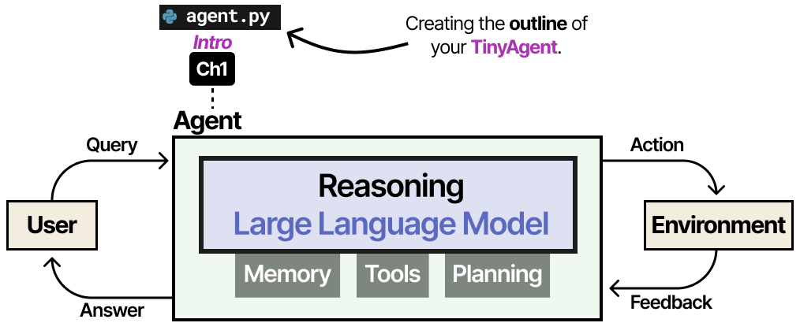
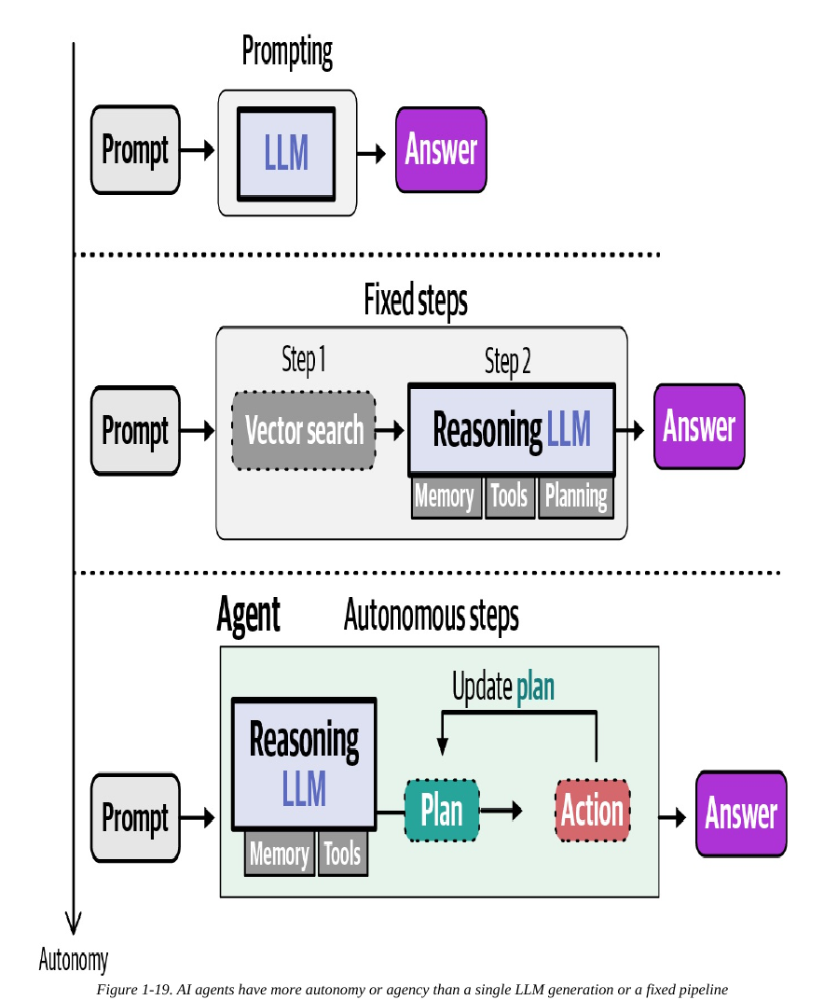
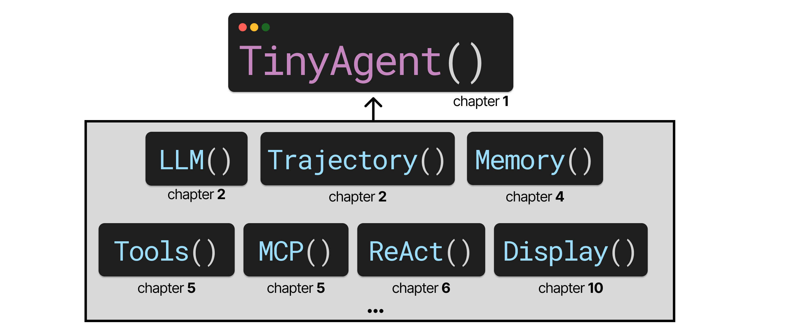

# Module 1 — What Is an AI Agent? (Lecture Notes)
**Course:** 307307 BI Methods for Generative AI — *Agentic AI half* | **University of Petra**
**Reference:** Grootendorst & Alammar, *An Illustrated Guide to AI Agents* (O'Reilly, 2026), Chapter 1.

> These notes are a reading companion for the Module 1 slides and lab. Don't worry if some terms are new — every one is defined on first use, and each is explored in depth in a later module.

## Learning Objectives
By the end of this module you should be able to:
- Define an **AI agent** and name the four parts of the classic agent model (environment, sensors, actuators, agent program).
- Explain why a plain LLM is *not yet* an agent, and what we add to turn one into an agent.
- Describe the four augmentations — **reasoning, memory, tools, planning/reflection** — in plain language.
- Explain that **autonomy is a spectrum**, not an on/off switch.
- Describe, at a high level, the `TinyAgent` you will build from scratch across the semester.

## 1. Introduction — from "talking" to "doing"
Until recently, large language models (LLMs) such as the one behind ChatGPT mostly **talked**: you typed a question, they produced text. An **AI agent** takes the next step — given a goal, some tools, and a bit of memory, it can **act**: search the web, run code, revise its own plan, and work through a problem over many steps with little hand-holding.

That shift — from generating text to *taking actions toward a goal* — is what this half of the course is about. Throughout, "AI agent" means an agent whose "brain" is an LLM (there are other kinds of agents in AI, but they are not our focus).

## 2. Core Concepts

### 2.1 What is an agent? (the classic definition)
A widely used definition comes from Russell & Norvig's *Artificial Intelligence: A Modern Approach*:

> *An agent is anything that can be viewed as perceiving its environment through sensors and acting upon that environment through actuators.*

This breaks into four parts:
- **Environment** — the world the agent works in (for us, mostly the digital world).
- **Sensors** — how the agent *observes* the environment.
- **Actuators** — how the agent *acts on* the environment (its tools).
- **Agent program** — the "brain": the rules that turn observations into actions.

*Analogy:* think of a driver. The road is the **environment**, the eyes are the **sensors**, the hands on the wheel are the **actuators**, and the driver's judgement is the **agent program**.

*Figure 1-1, An Illustrated Guide to AI Agents (O'Reilly, 2026).*

### 2.2 The same picture, in LLM terms
For an LLM-backed agent:
- The **agent program / brain** is a **reasoning LLM** — a model that can "think" through a problem.
- The **actuators** are the LLM's **tools** (web search, a calculator, code execution, …).
- The **sensors** are the model's ability to take in information — text, and sometimes images or audio (multimodality).
- The **user** is part of the environment: they usually start the interaction by stating a request.

This single picture — a reasoning LLM, surrounded by memory, tools, and planning, in a loop with a user and environment — is the backbone of the whole course. Every later module adds one piece to it.

*The anatomy of an agent (the figure that anchors the whole book). An Illustrated Guide to AI Agents (O'Reilly, 2026).*

### 2.3 The brain: LLM, then reasoning LLM
- A plain **LLM** predicts the next **token** (a sub-word piece of text) given the input, then feeds its own output back in and predicts again. This loop is called **autoregression**, and it's how the model writes a full answer one token at a time.
- A **reasoning LLM** is trained to "think out loud" first — it generates intermediate **reasoning tokens** before the final answer. Spending compute on structured thoughts makes multi-step problems much easier. Reasoning models are better at planning, choosing tools, and recovering from mistakes; plain models are faster and cheaper. *(Explored in Modules on LLMs / Reasoning.)*

### 2.4 Augmenting the brain
A reasoning LLM alone is still just text-in / text-out. It has **no memory** of past turns and **cannot act** on the world. We add:

- **Memory** — LLMs are **stateless**: by default they forget previous turns. The simplest fix is to paste the conversation history back into the prompt. Real memory systems are richer (short-term vs long-term), and because too much context *hurts* performance (**information overload**), we practice **context engineering**: giving the model the *right* information, not all of it.
- **Tools** — an LLM can only **express the intent** to act. Asked "What is 5.1 × 7.3?", it can output the text `multiply(5.1, 7.3)` — but that string does nothing until *our* software parses it and runs the real function, then feeds the result back. The **Model Context Protocol (MCP)** is a standard way to connect tools so different models can reuse them.
- **Planning & reflection** — **planning** breaks a big task into smaller steps (**task decomposition**); **reflection** lets the agent look back, notice a step didn't work, and revise the plan. Together they form a loop: *plan → act → observe → reflect → update.*

A reasoning LLM augmented with memory and tools is what Anthropic calls the **"augmented LLM."** Add planning and reflection and you have an **AI agent**.

### 2.5 Autonomy is a spectrum
Agents differ in **how much freedom** they have:
- **Prompting** — one LLM call, one answer (not an agent).
- **Fixed steps** — a pipeline with a set order of steps (partially agentic).
- **Agent / autonomous steps** — the model decides which steps to take, in what order, and when to stop.

A system is "more agentic" the more control the LLM has over its own actions. But full autonomy is not always desirable: **guardrails** keep an agent from taking harmful or irreversible actions (like deleting important files). As long as a system shows **goal-directed behavior** and **makes decisions**, we can reasonably call it an agent.

*Figure 1-19 — autonomy is a spectrum: prompting → fixed steps → agent. An Illustrated Guide to AI Agents (O'Reilly, 2026).*

## 3. Real-World Examples
- **Coding agents** (e.g., terminal and IDE assistants) — read a codebase, write new functions, run and test them. A strong fit because the goal is clear and the result can often be checked automatically.
- **Deep research** — given a topic, the agent searches many sources and synthesises a report with little supervision.
- **Automation** — structuring messy data across systems (for example, organising records stored differently across hospitals) so people can work with it.

## 4. Common Misconceptions
- **"An LLM is an agent."** No — a plain LLM only produces text. It becomes an agent only once we add memory, tools, and planning around it and let it act.
- **"The LLM runs the tool itself."** No — the LLM only outputs *text expressing intent*. Your program must detect that intent, run the real action, and return the result. This boundary is also a safety feature: a request to act is **not** authorization to act.
- **"Agent means fully autonomous."** No — autonomy is a dial. Many useful agents are deliberately kept on a short leash with humans in the loop.

## 5. Responsible Use (connects to the Governance half of this course)
Because agents can *act*, not just talk, they need care:
- **Human in the loop** — have a person authorize, check, or audit important decisions.
- **Guardrails** — limit autonomy to what the task actually needs.
- **Misinformation / hallucinations** — agents are still LLMs and can state wrong things confidently; add checks where correctness matters.

These themes are exactly where the second half of the course — **AI governance** — picks up.

## 6. What You Will Build: the `TinyAgent`
Rather than hide everything behind a framework, you will build a small agent **from scratch**, one module at a time, so you can *see* how each part works:

*The TinyAgent and its modules, added chapter by chapter. An Illustrated Guide to AI Agents (O'Reilly, 2026).*

| Week / Module | Piece added | New capability |
|---|---|---|
| M1 (now) | `agent.py` skeleton | Basic structure; no brain yet (it just echoes you) |
| LLMs | `llm.py` | Can query an LLM (still stateless) |
| Memory | `memory.py` | Remembers the conversation |
| Tools | `tools.py` (+ MCP) | Can call tools |
| Planning | `planning.py` (ReAct) | Multi-step, autonomous behavior |

In the lab you connect this skeleton to **Google's Gemini API** (the same free setup used in your Practical folder) and watch it go from "parrot" to a model that actually answers.

## 7. Summary
- An **agent** perceives an environment through **sensors** and acts on it through **actuators**, guided by an **agent program** (the brain).
- For us the brain is a **reasoning LLM**, augmented with **memory, tools, and planning/reflection**.
- A plain LLM is not an agent; the augmentations and the action loop are what make it one.
- **Autonomy is a spectrum**, and guardrails + humans-in-the-loop matter.
- You will build these ideas yourself as the **`TinyAgent`**.

## Review Questions
1. State the Russell & Norvig definition of an agent and map its four parts onto an LLM-backed agent.
2. Why is a stateless LLM a problem for a multi-turn conversation, and what is the simplest way to give it "memory"?
3. When an LLM outputs `multiply(5.1, 7.3)`, has a tool been used? Explain what still has to happen — and why this is also a safety boundary.
4. Give one example each of *prompting*, *fixed steps*, and an *autonomous agent*, and say what makes them more or less "agentic".
5. Name the four augmentations that turn a reasoning LLM into an agent, and the course module where each is built.

---
*Figures in the slides are reproduced from Grootendorst & Alammar, An Illustrated Guide to AI Agents (O'Reilly, 2026), for internal University of Petra classroom use.*
