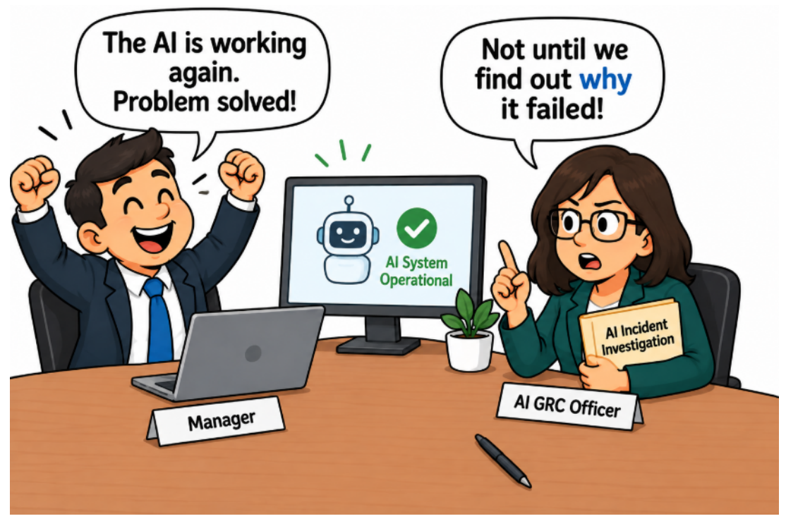
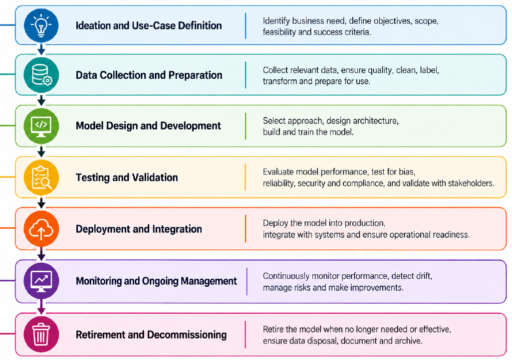
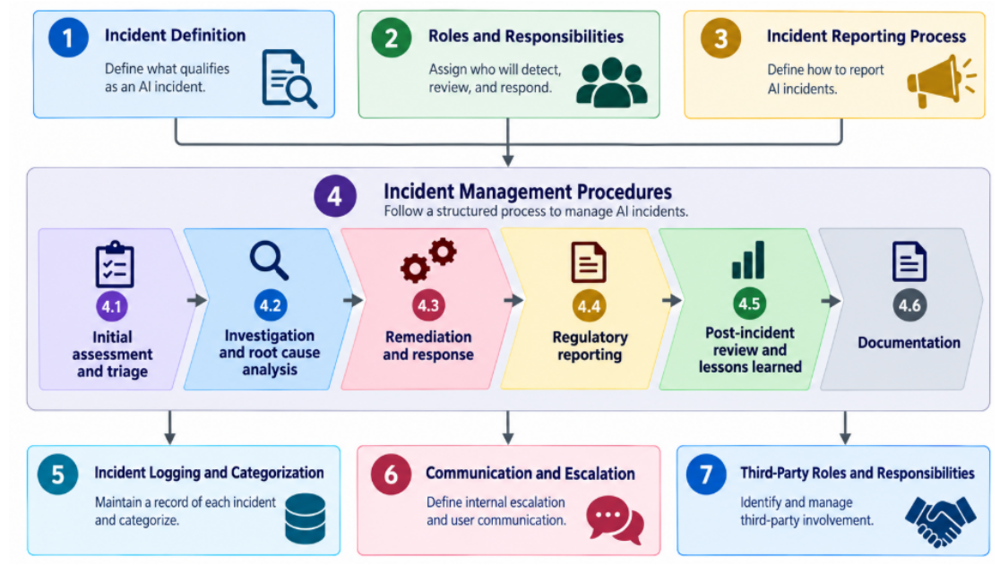
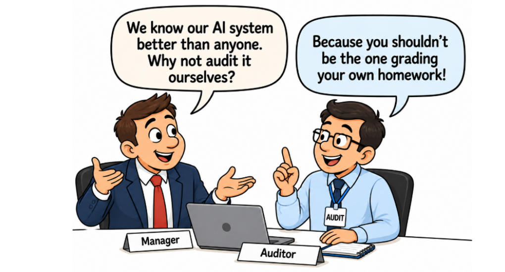

# Module 10 — Lifecycle, Incidents and Audit (Lecture Notes)
**Course:** 307307 BI Methods for Generative AI — *AI Governance half* | **University of Petra**
**Reference:** Hemang Doshi, *AI Governance in Practice* (Packt, 2026), Chapters 14, 15, 16 and 17.

> Modules 6 to 9 built the foundations: principles, rules, the management system, the structure and the risk assessments. This last module follows an AI system **through time**. We govern it across its **lifecycle**, protect it against **AI-specific security threats**, respond when something goes wrong through **incident management**, and finally prove that it all works through an **independent audit**.

*Figure 16.1 — fixing is not learning. From AI Governance in Practice (Hemang Doshi, Packt, 2026).*

## Learning Objectives
By the end of this module you should be able to:
- Describe the **seven stages of the AI lifecycle** and the governance checkpoint at each one.
- Name the main **AI-specific security threats** and the three things to protect: **data, models and infrastructure**.
- Recognize an **AI incident**, rank its severity and follow the **incident process**, including the **incident register**.
- Explain why an **AI audit must be independent**, what it examines, and what the AI GRC officer does (and does not do) during it.

## 1. Governance across the AI lifecycle
Governance is not a gate at the end. It starts before the first line of code and continues after the system is switched off. The book divides the lifecycle into **seven stages**. It calls this an **illustrative** model: other organizations may use different names or split the stages differently.

*Figure 14.2 — the AI lifecycle. From AI Governance in Practice (Hemang Doshi, Packt, 2026).*

| # | Stage | Governance checkpoint |
|---|---|---|
| 1 | Ideation and use-case definition | Use-case proposal and approval; first risk classification; ethical and societal impact |
| 2 | Data collection and preparation | Data quality, privacy and consent checks; bias in the data |
| 3 | Model design and development | Documented design choices; explainability and security built in |
| 4 | Testing and validation | **Independent** testing (accuracy, bias, robustness); formal sign-off |
| 5 | Deployment and integration | Go-live authorization; access control, logging, human oversight, transparency |
| 6 | Monitoring and ongoing management | Watch for drift and bias; incident process; approve retraining; re-check the risk class |
| 7 | Retirement and decommissioning | Approved shutdown; secure data disposal; keep audit records; lessons learned; update the inventory and risk register |

### After go-live, where risk grows
- **Drift:** real-world data changes, so accuracy slowly falls although the code is the same. Think of a map that was correct five years ago.
- **Bias reviews:** outcomes must stay fair for all groups, not only on launch day.
- **Retraining:** a retrained model is a **changed** model. It needs testing and approval before it replaces the old one.
- **Reclassifying risk:** a new feature or use (a tool that used to recommend and now decides) can move a system into a higher risk class.

### Third-party AI
For bought systems the organization cannot see inside, lifecycle control rests on four things: **due diligence** before buying, **AI requirements in the contract**, **independent evidence** such as an ISO/IEC 42001 certificate or audit report, and **ongoing monitoring** after go-live.

## 2. AI security (a light touch)
Chapter 15 is mostly for security specialists. For governance, it is enough to know that AI adds new ways to attack a system, and that someone must own each risk.

| Threat | In plain words |
|---|---|
| Data poisoning | Bad data is slipped into the training data so the model learns the wrong thing |
| Adversarial attack | Inputs crafted to fool a model, such as a sticker that makes a camera misread a sign |
| Prompt injection | Hidden instructions in text that make a chatbot ignore its rules |
| Model theft or extraction | Copying a model by sending it many queries and studying the answers |
| Model inversion | Recovering private training data from what the model outputs |
| AI supply chain attack | A tampered pre-trained model, library or dataset is brought in from outside |
| Denial of service | Overloading the system so honest users cannot use it |

*Threat list from Chapter 15. Plain-language examples are ours.*

**What to protect:**
- **Data:** classify and limit access, encrypt and mask sensitive fields, check quality and lineage, set retention, back up.
- **Models:** control access and versions, validate and security-test, approve every change, check outputs, retire safely.
- **Infrastructure:** keep an inventory, harden and patch, strong identity (MFA, least privilege), separate networks, log activity, keep the service available.

**Who does what:** the **CISO** (chief information security officer) and security teams run the controls. The **AI GRC officer** makes sure AI-specific risks are covered and not forgotten.

## 3. AI incident management
### What is an AI incident?
An **AI incident** is an event where an AI system behaves in a way that **causes or may cause** harm, noncompliance or significant risk. The words *may cause* matter: a near miss is already an incident, and repeated small problems count too.

The book opens with a bank where the **loan rejection rate for one customer group** rose after a data change. Nothing crashed and nothing was hacked, yet it is clearly an AI incident.

When judging how seriously to take an event, consider: **criticality** of the system, **severity** of the effect, **sensitivity of the data**, **regulation** (a duty to report?), **AI-specific risks** (bias, drift, poisoning, prompt injection) and **recurrence**.

### Turning "serious" into numbers
Written thresholds mean that two people reach the same severity. The book gives **illustrative** values; each organization sets its own.

| Area | Example trigger for higher severity |
|---|---|
| Downtime | A critical AI system is down for more than 30 minutes |
| People affected | 10 or more customers affected |
| Money | Direct loss of USD 10,000 or more |
| Performance | Accuracy falls 10%, or the error rate rises 20% |
| Data | Any exposure of sensitive data |
| Security | Confirmed unauthorized access; a successful prompt injection that bypasses a control |
| Compliance and governance | A regulatory breach; AI deployed or changed without approval |

*Illustrative values based on Table 16.1 of the book.* Some triggers need no number at all: any sensitive data exposure is serious.

### The framework

*Figure 16.2 — incident management framework. From AI Governance in Practice (Hemang Doshi, Packt, 2026).*

The framework has seven parts: **definition, roles and responsibilities, reporting process, procedures, logging and categorization, communication and escalation, third-party roles**. AI incidents should **join the organization's existing IT, cyber and privacy incident process**, not form a separate one, and be treated as high priority.

### The incident process in six steps
1. **Triage:** log it, judge severity, decide who must be told.
2. **Investigate:** find the **root cause**, not only the symptom.
3. **Respond:** contain the harm, fix it, check the fix works.
4. **Report:** check legal and contract duties to notify.
5. **Review:** hold a post-incident review and write down lessons.
6. **Document:** keep the evidence and update the register.

Lessons should change policies, risk assessments, controls, monitoring or training.

### The incident register
AI incidents go into the **common incident register**, tagged as AI (for example "Cybersecurity – AI" or "AI – Fairness"). Fields include ID and date, category, affected system, description, severity, business impact, owner, initial action, root cause, corrective action with owner and due date, regulatory reporting, status, closure date and lessons learned (Table 16.2).

*Invented example:* INC-014 · AI – Accuracy · Study Buddy · wrong exam date given to 40 students · High · owner: Head of Student Services · root cause: old timetable left in the chatbot's sources · action: add a review step, IT, due 30 April · status: open.

The AI GRC officer reviews the register for **repeat incidents, overdue actions and repeated control failures**. The aim is not to close incidents but to strengthen governance.

### Common pitfalls
No clear definition · a separate process · delayed reporting · a technical-only view · unclear roles · poor escalation · incomplete records · **closing without root cause** · untracked corrective actions · ignoring third-party responsibilities · treating closure as the end. The book ends the chapter with a checklist of 22 items to test whether the process is both documented and working.

## 4. AI audit

*Figure 17.1 — audit independence. From AI Governance in Practice (Hemang Doshi, Packt, 2026).*

### Why independent?
The book's hospital has everything on paper: policy, roles, risk assessment, documentation, testing, oversight, monitoring, an incident process. What is missing is **independent oversight**. The people who run the system also judge it. An independent review might find that accuracy is fine overall but much lower for one patient group. AI audits also go deeper than IT audits: type of AI, training data, model behavior, explainability, human oversight and continuous monitoring.

### Who does what
- **Audits:** the **internal audit** function, led by the **Chief Audit Officer (CAO)**, with AI knowledge. If skills are missing, an **independent external assessor** (the CAO checks independence and qualifications).
- **Supports:** the **AI GRC officer** coordinates the audit, supplies documents, explains processes, covers AI risks and regulations in the scope, tracks remediation and reports to management. The officer **must not audit controls they are responsible for governing** (self-review).
- **Operates the controls:** system owners, technology leaders and the CISO, who provide evidence and fix findings.

### What an AI audit examines
Governance and oversight · data quality and integrity · bias and fairness · transparency and explainability · security · privacy and compliance · model performance and reliability · human oversight and accountability · incident management. The auditor checks whether controls are **designed, implemented and operating**, not only whether policies exist. A detailed checklist is Template 11 in the book.

### How an audit works
Understand the control → obtain evidence → test the control → identify exceptions → assess the risk → document the finding → agree corrective action → follow up.

### Internal and external audits
- **Internal AI audit:** performed by the organization's internal audit function; independent assurance to management and the committee. ISO/IEC 42001 requires **internal audits**.
- **External AI audit:** performed by an independent third party when expertise or independence is needed. **ISO/IEC 42001 certification** is an external audit by a certification body.

## 5. Common Misconceptions
- **"The system is working again, so the incident is closed."** No. Close it when the root cause is fixed and lessons are used.
- **"No one was harmed, so it is not an incident."** No. An event that *may* cause harm counts.
- **"AI incidents need their own separate process."** No. Join the existing incident process and register.
- **"Governance ends at go-live."** No. Monitoring, retraining, reclassification and retirement are governance tasks.
- **"We bought it, so the vendor is responsible."** Not entirely. Due diligence, contracts and monitoring remain the organization's job.
- **"The AI GRC officer can audit the governance program they built."** No. That is self-review.

## 6. Summary
- Governance follows AI through **seven lifecycle stages**, each with a checkpoint.
- AI adds new **security threats**; protect **data, models and infrastructure**.
- An **AI incident** is any event that causes or may cause harm. Use **thresholds**, a **common register** and **root cause analysis**.
- Close incidents only when the cause is fixed and the lessons are used.
- An **independent audit** tests whether controls really work. The AI GRC officer **supports** but does not audit their own controls.

## Review Questions
1. Name the seven lifecycle stages. Choose two and describe the governance checkpoint at each.
2. Why is retirement a governance task? What should happen at that stage?
3. Explain drift. Why must retraining go through approval?
4. What can the organization still do about the lifecycle of a system it buys from a vendor?
5. Give three AI-specific security threats in your own words.
6. Define an AI incident. Why do the words "may cause" matter?
7. Why do organizations write numerical thresholds for incident severity? Give two examples.
8. Describe the six steps of the incident process. Why is root cause analysis important?
9. Why should AI incidents use the common incident register?
10. Why must an AI audit be independent? What does the AI GRC officer do during an audit?
11. List four areas an AI audit examines.
12. What is the difference between an internal and an external AI audit? Which one is ISO/IEC 42001 certification?

---
*Figures in these notes and slides are reproduced from Hemang Doshi, AI Governance in Practice (Packt, 2026), for internal University of Petra classroom use. The University of Petra scenario in the activity is fictional.*
