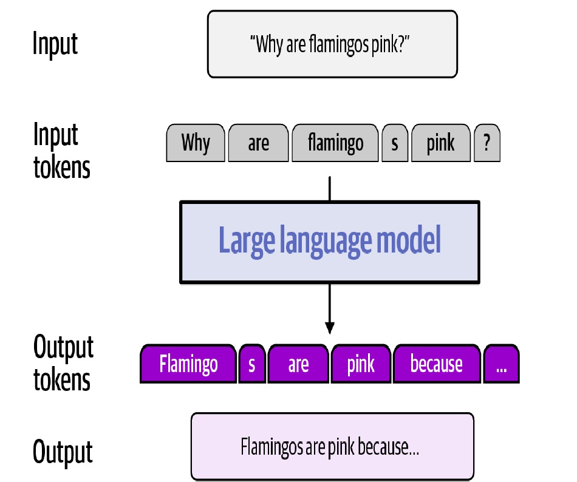
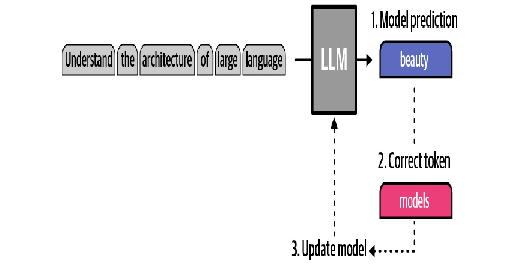
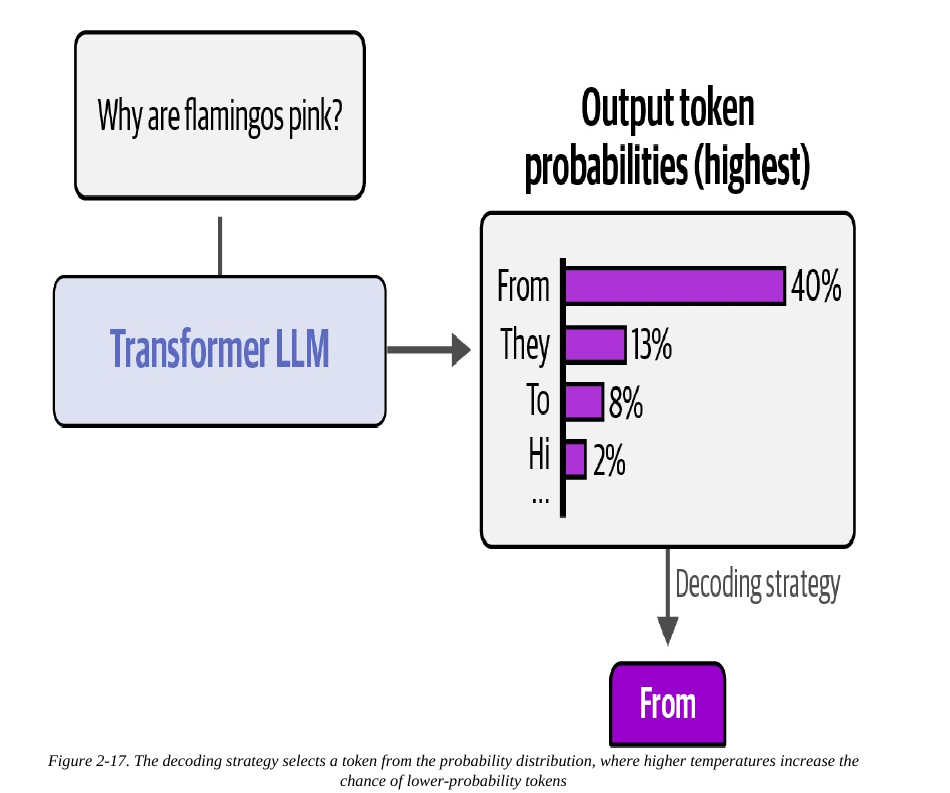
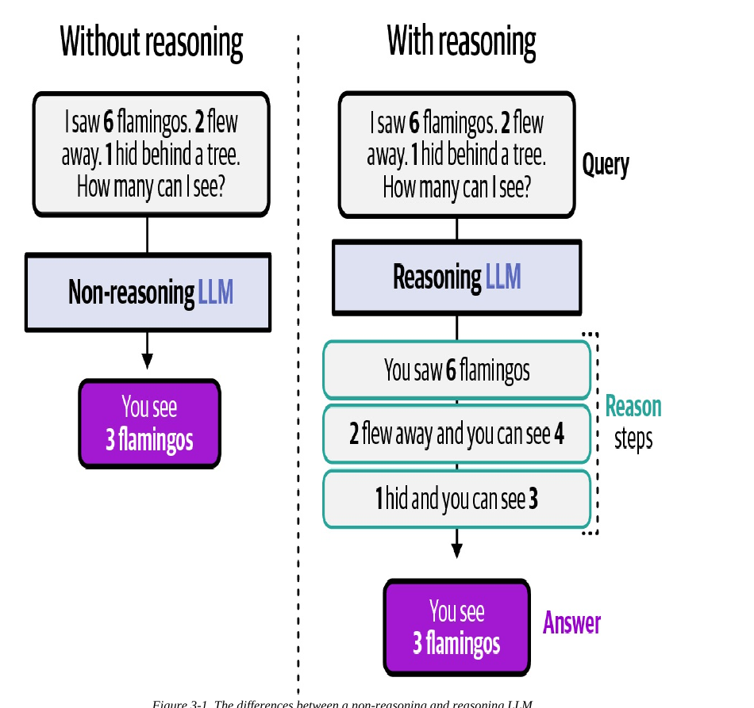

# Module 2 — LLMs & Reasoning: The Brain (Lecture Notes)
**Course:** 307307 BI Methods for Generative AI — *Agentic AI half* | **University of Petra**
**Reference:** Grootendorst & Alammar, *An Illustrated Guide to AI Agents* (O'Reilly, 2026), Chapters 2–3.

> In Module 1 we built the `TinyAgent` skeleton — structure with no brain. This module is about that brain: the **large language model (LLM)**. By the end you'll understand what an LLM really does, how it's trained, how we talk to it, and what makes a *reasoning* LLM different. In the lab you give the skeleton a real, reusable brain.

## Learning Objectives
By the end of this module you should be able to:
- Explain what an LLM does: **tokens**, **next-token prediction**, and the **autoregressive** loop.
- Describe at a high level how an LLM is trained: **pre-training** then **post-training** (SFT + RL).
- Use the **chat message format** (system / user / assistant) to talk to a model.
- Explain **temperature** and the **context window**, and why they matter for agents.
- Explain what a **reasoning LLM** is (System 1 vs System 2) and when to use one.
- Choose a model and connect to it through an **OpenAI-compatible endpoint**.

## 1. What is an LLM?
A **large language model** is a system trained to **predict the next token** in a sequence. A **token** is a small piece of text — a word, part of a word, a number, or punctuation (for example, *"flamingos"* becomes two tokens, *"flamingo"* + *"s"*).

The model takes your input, splits it into tokens, and predicts the most likely next token. Then it does something clever: it **adds that token to the input and predicts again**, over and over, building the answer one token at a time. Because the model consumes its own output as new input, this is called an **autoregressive** loop.

*Analogy:* predictive text on your phone, but far more powerful — it keeps predicting the next word, using everything written so far, until the thought is complete.

*Figure 2-3, An Illustrated Guide to AI Agents (O'Reilly, 2026).*

## 2. How is an LLM trained? (high level)
Training happens in two phases:

- **Pre-training** — the model reads enormous amounts of text (web pages, books, code) and plays one game billions of times: *hide the next token, guess it, check against the real token, adjust.* The result is a **base model** with broad knowledge but not much "manners."
- **Post-training** — polishes the base model:
  - **Supervised fine-tuning (SFT)** — show the model example *prompt → good answer* pairs so it learns to **follow instructions**.
  - **Reinforcement learning (RL)** — instead of giving the exact answer, **score** the model's answers and nudge it toward higher-scoring ones. Two common flavors: **RLHF** (humans or a reward model rate which answer is better) and **RLVR** (a score is computed automatically — e.g. "is the math answer correct?").

*You do not need the math.* The takeaway: pre-training gives knowledge; post-training gives helpfulness and, as we'll see, reasoning.

*Pre-training as next-token prediction (Figure 2-8). An Illustrated Guide to AI Agents (O'Reilly, 2026).*

## 3. Talking to an LLM: the chat format
Modern LLMs are used as a **conversation** with labelled turns (**roles**):
- **system** — a privileged instruction that sets behavior *before* the user says anything ("You are a helpful study planner."). The deployer uses it to steer the model.
- **user** — what the person asks.
- **assistant** — what the model replies.

We send a **list of messages** and get a reply back. This same format is how we later give the agent memory (pass the history back) and tools (the model emits a tool call). The response can also contain extra fields such as `reasoning` and `tool_calls` — we'll use those in later modules.

## 4. Two knobs every agent builder should know
- **Temperature** — after the model scores all possible next tokens, the **decoding strategy** picks one. Temperature **0** always takes the highest-probability token (focused, repeatable). Higher temperature allows **sampling** lower-probability tokens (more varied, more creative, less predictable). For agents that must be reliable, low temperature is often safer.

  
  *Figure 2-17, An Illustrated Guide to AI Agents (O'Reilly, 2026).*
- **Context window (context length)** — the maximum number of tokens the model can handle at once (input + output). Everything the agent "knows" in a turn must fit here. Because space is limited and *too much* context can hurt, we practice **context engineering**: give the model the *right* information, not all of it. (This is the Memory module's job, next.)

## 5. Reasoning LLMs
A plain LLM answers immediately. A **reasoning LLM** is trained to **"think out loud" first** — it generates intermediate **reasoning tokens** (a chain of thought) before the final answer.

A useful analogy is Kahneman's **System 1 vs System 2**:
- **System 1** — fast, automatic, intuitive. Like a **non-reasoning** LLM: quick answers from learned patterns.
- **System 2** — slow, deliberate, step-by-step. Like a **reasoning** LLM: works through the problem and catches mistakes.

*Figure 3-1 — without reasoning vs with reasoning. An Illustrated Guide to AI Agents (O'Reilly, 2026).*

This connects to a big shift in the field: from **train-time compute** (make the model bigger, train on more data) to **test-time compute** (let the model *think longer at answer time*). Reasoning models spend more tokens — more "thinking" — to reach better answers on hard, multi-step problems.

**Why agents need reasoning:** planning, choosing tools, and reflecting on results all require step-by-step thought. Fast non-reasoning models are cheaper and fine for simple tasks; reasoning models shine on complex ones.

## 6. Choosing and connecting to a model
There are hundreds of models. Two practical axes:
- **Open-weight vs proprietary** — open models (e.g. Gemma, Qwen) you can run yourself; proprietary models (e.g. Gemini, GPT, Claude) you call as a service.
- **Local vs cloud** — run locally with **Ollama** / **LM Studio** / **llama.cpp**, or use a **cloud** provider's free tier (Google **Gemini**, OpenRouter, etc.).

The unlock: almost all of them expose an **OpenAI-compatible endpoint** — the same request shape (`base_url`, `api_key`, `model`, `messages`). So one small wrapper class can talk to *any* of them by swapping the URL and model name. **In this course we use Google Gemini's free tier** through that endpoint — the same setup as your Practical folder.

## 7. The book's teaching philosophy (worth knowing)
Newer models can do reasoning and tool calls **natively** (built-in fields). That's convenient but "magical" — it hides *how* it works. So the book (and this course) often builds these behaviors **by prompting first**, so you understand the mechanics, then shows the native version. That's why early modules sometimes "do it the hard way" on purpose.

## 8. Common Misconceptions
- **"The LLM looks things up."** No — it predicts likely tokens from patterns learned in training. It can be confidently wrong (a **hallucination**).
- **"Bigger is always better."** Not anymore — reasoning (test-time compute) and good post-training often beat raw size, and a small model may be the right, cheaper choice.
- **"Temperature 0 means correct."** No — it means *repeatable*, not *true*. Low temperature reduces randomness, not errors.
- **"The system prompt is just another message."** It's privileged — it shapes behavior and takes precedence over user instructions.

## 9. Summary
- An LLM predicts the **next token** and builds answers **autoregressively**.
- Training = **pre-training** (knowledge) + **post-training** (SFT + RL for helpfulness).
- We talk to it with **system/user/assistant** messages; **temperature** and **context window** are key knobs.
- A **reasoning LLM** thinks step-by-step (System 2) — essential for planning, tools, and reflection.
- Models are interchangeable through the **OpenAI-compatible endpoint**; we use **Gemini**.

## Review Questions
1. What is a token, and what does "autoregressive" mean?
2. Name the two training phases and, for post-training, the difference between SFT and RL.
3. What do the system, user, and assistant roles each do?
4. What does temperature control? What happens at temperature 0?
5. Explain the System 1 / System 2 analogy for non-reasoning vs reasoning LLMs, and give one task where you'd prefer each.
6. Why does an OpenAI-compatible endpoint make it easy to switch models?

---
*Figures in the slides are reproduced from Grootendorst & Alammar, An Illustrated Guide to AI Agents (O'Reilly, 2026), for internal University of Petra classroom use.*
