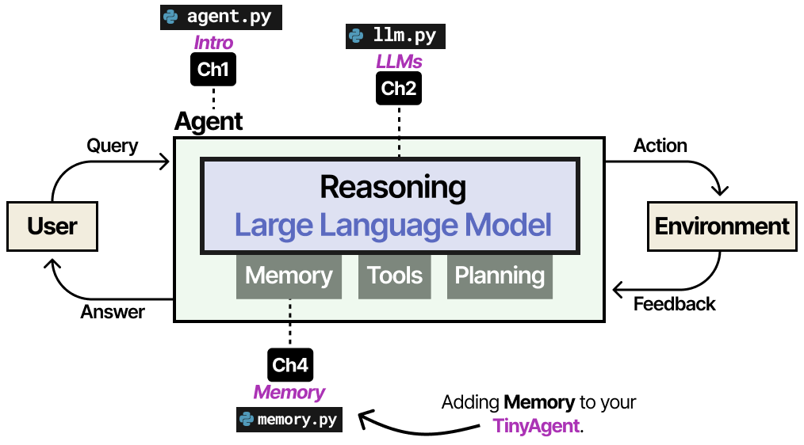
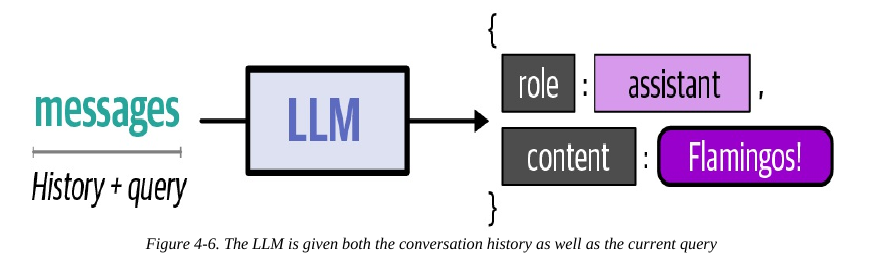
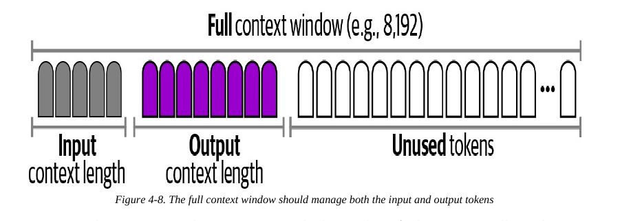
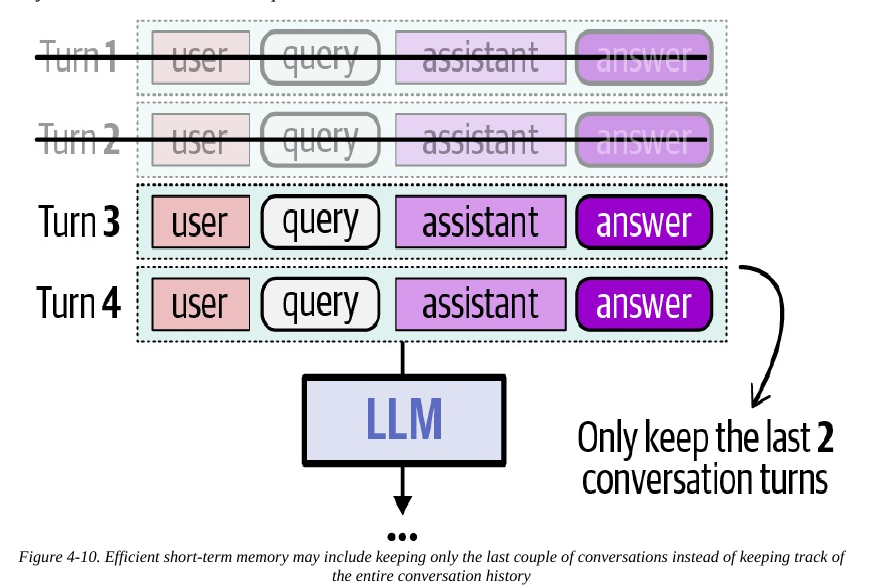
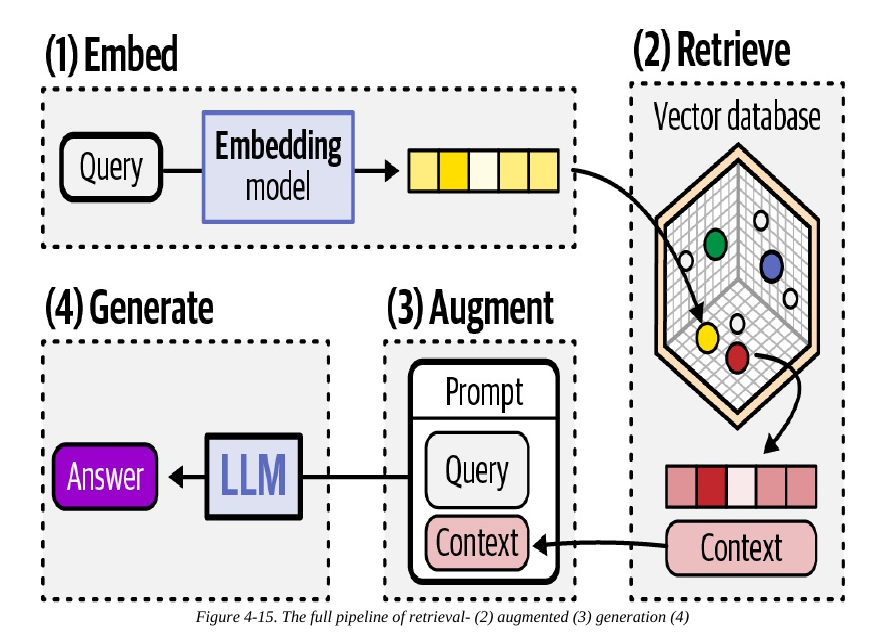

# Module 3 — Memory (Lecture Notes)
**Course:** 307307 BI Methods for Generative AI — *Agentic AI half* | **University of Petra**
**Reference:** Grootendorst & Alammar, *An Illustrated Guide to AI Agents* (O'Reilly, 2026), Chapter 4.

> In Module 2 we gave the `TinyAgent` a brain — but it still forgets everything the moment it answers. This module fixes that. We give the agent **memory**, so it can hold a real conversation and draw on outside knowledge. In the lab you add a tiny `Memory` module and watch the agent finally remember your name.

## Learning Objectives
By the end of this module you should be able to:
- Explain why LLMs are **stateless** and what that means for an agent.
- Describe **short-term memory** as the conversation history fed back into the prompt.
- Explain the **context window** limit and two ways to manage it: **trimming** and **summarization**.
- Describe **long-term memory**, how **RAG** (retrieval-augmented generation) works, and what a **vector database** does.
- Connect memory to **context engineering** and to reducing **hallucinations**.

## 1. The problem: LLMs are stateless
By themselves, LLMs **do not remember**. Every call starts from a blank slate — ask an LLM your name, tell it, ask again, and it won't know. The chat apps you use (ChatGPT, Claude) *feel* like they remember only because they are LLMs **augmented with a memory module** that re-sends the conversation each time.

So the agent never truly "remembers" — **we tell it** what happened before by putting the history back into the prompt.


*Adding Memory to the TinyAgent. An Illustrated Guide to AI Agents (O'Reilly, 2026).*

## 2. Types of memory (the big picture)
Agent memory is often modelled on human memory. A useful split:
- **Working memory (short-term)** — the ongoing conversation; data that persists across calls. For us: the **chat history**.
- **Long-term memory** — kept in an external store and retrieved when needed:
  - **Episodic** — specific past events/actions the agent took.
  - **Semantic** — general knowledge about the world or your documents (e.g. your codebase, a wiki).
  - **Procedural** — how to do things (often baked into the system prompt or the model's own parameters).

Memory isn't only *remembering* — it's also deciding **what to store, what to recall, and what to forget**.

## 3. Short-term memory = conversation history
The simplest, most fundamental memory is just a **list of messages** (role + content) that we append to as the conversation goes:
```
[
  {"role": "user", "content": "We are Maarten and Jay."},
  {"role": "assistant", "content": "Hi Maarten and Jay!"},
  ...
]
```
Every time we ask something new, we send the **whole list** back to the LLM. That's how it "remembers" — the information is in the prompt, not inside the model.


*Figure 4-6, An Illustrated Guide to AI Agents (O'Reilly, 2026).*

*In the lab:* a `Memory` class with just `.add(role, content)` and `.get_messages()` — about 15 lines — turns the forgetful agent into one that holds a conversation.

## 4. The catch: the context window
An LLM can only process so many tokens at once — its **context window** (e.g. 8,192 tokens), counting **both input and output**. As a conversation grows, the history grows too, and eventually it **won't fit**: the answer gets cut off, or the model can't process the prompt at all. Also, **more context makes it harder** for the model to focus on what matters.


*Figure 4-8, An Illustrated Guide to AI Agents (O'Reilly, 2026).*

So we can't always send the entire history. Two common fixes:

- **Trimming** — keep only the most recent turns (e.g. the last two), dropping older ones. Simple, but you may throw away something important from earlier.

  
  *Figure 4-10 — trimming keeps only the most recent turns. An Illustrated Guide to AI Agents (O'Reilly, 2026).*
- **Summarization** — use an LLM to **compress** older turns into a short running summary, kept alongside the recent messages. Saves space while retaining the gist, though repeated summarizing can lose detail.

*Keep the raw conversation in the trajectory* (from Module 2) even when the agent's memory is trimmed or summarized — so you can always see what really happened.

## 5. Long-term memory and RAG
When knowledge lives **outside** the conversation — your documents, a knowledge base — we use **long-term memory**, most commonly via **Retrieval-Augmented Generation (RAG)**.

RAG in four steps:
1. **Embed** — turn text into a numeric vector (an **embedding**) with an embedding model. Similar meanings get similar vectors.
2. **Retrieve** — embed the user's question too, and find the stored items **most similar** to it (measured by **cosine similarity**). Keep the top few.
3. **Augment** — add those retrieved pieces to the prompt as *context* alongside the question.
4. **Generate** — the LLM answers using that added context.


*Figure 4-15 — the four steps of retrieval-augmented generation. An Illustrated Guide to AI Agents (O'Reilly, 2026).*

**Where do the vectors live?** The embeddings are kept in a **vector database**: a database built to store each vector together with its original text (and often *metadata*, such as the source or the date) and to return the stored items most similar to a query vector. For a handful of documents you can simply compare the question with every vector — that is what the lab does. For millions of vectors that becomes slow, so vector databases build an **index** that finds the *approximately* nearest vectors much faster, accepting a small chance of missing a true nearest neighbour. Examples: Chroma, Qdrant, Pinecone, Weaviate, Milvus, and the pgvector extension for PostgreSQL. (FAISS is a similarity-search *library* rather than a full database.)

Two practical points:
- **Chunking.** Long documents are usually split into smaller **chunks** before embedding, so that each vector stands for one focused piece of text.
- **Same model.** Embed the documents and the questions with the **same** embedding model; vectors from different models cannot be compared.

RAG is a major tool for **reducing hallucinations**: by handing the model relevant, trusted facts, it's less likely to make things up. (A more advanced version, **agentic RAG**, lets the agent *decide* what to look up and how often — we meet it again in Module 5.)

## 6. Context engineering (the thread)
All of this is **context engineering**: giving the model the **right** information for the task, not **all** the information. Memory is where context engineering lives — choose what to keep, what to summarize, and what to retrieve.

## 7. Common Misconceptions
- **"The agent remembers."** No — the model is stateless. The memory module **re-sends** the history each call; remembering is an illusion we create.
- **"Just send the whole history every time."** It eventually overflows the context window and can dilute the model's focus. Manage it (trim/summarize/retrieve).
- **"RAG makes the model smarter."** RAG adds **relevant facts to the prompt**; it doesn't change the model. Bad retrieval → bad answer.
- **"RAG always finds the right document."** A vector search returns the *nearest* items even when none of them is relevant. Look at what was retrieved; weak retrieval gives a weak answer.
- **"More context is always better."** Too much context hurts focus and costs more tokens.

## 8. Summary
- LLMs are **stateless**; memory is a module that **re-sends** information.
- **Short-term memory** = the conversation history (a list of messages).
- The **context window** is limited → manage it with **trimming** or **summarization**.
- **Long-term memory** = external knowledge via **RAG** (embed → retrieve → augment → generate); the vectors are kept in a **vector database**.
- It's all **context engineering**, and good memory reduces **hallucinations**.

## Review Questions
1. Why is an LLM "stateless," and how does a memory module make it seem to remember?
2. What is the simplest form of short-term memory, and what does it actually contain?
3. What is the context window, and what are two ways to keep a long conversation within it?
4. List the four steps of RAG and say what "cosine similarity" is used for.
5. How does giving the model retrieved context help reduce hallucinations?
6. What does a vector database store, and why must documents and questions be embedded with the same model?

---
*Figures in the slides are reproduced from Grootendorst & Alammar, An Illustrated Guide to AI Agents (O'Reilly, 2026), for internal University of Petra classroom use.*
