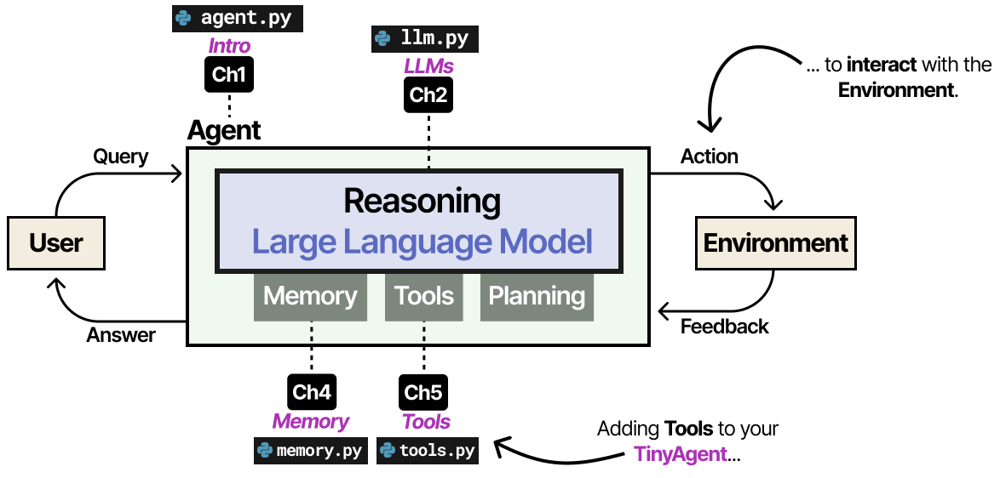
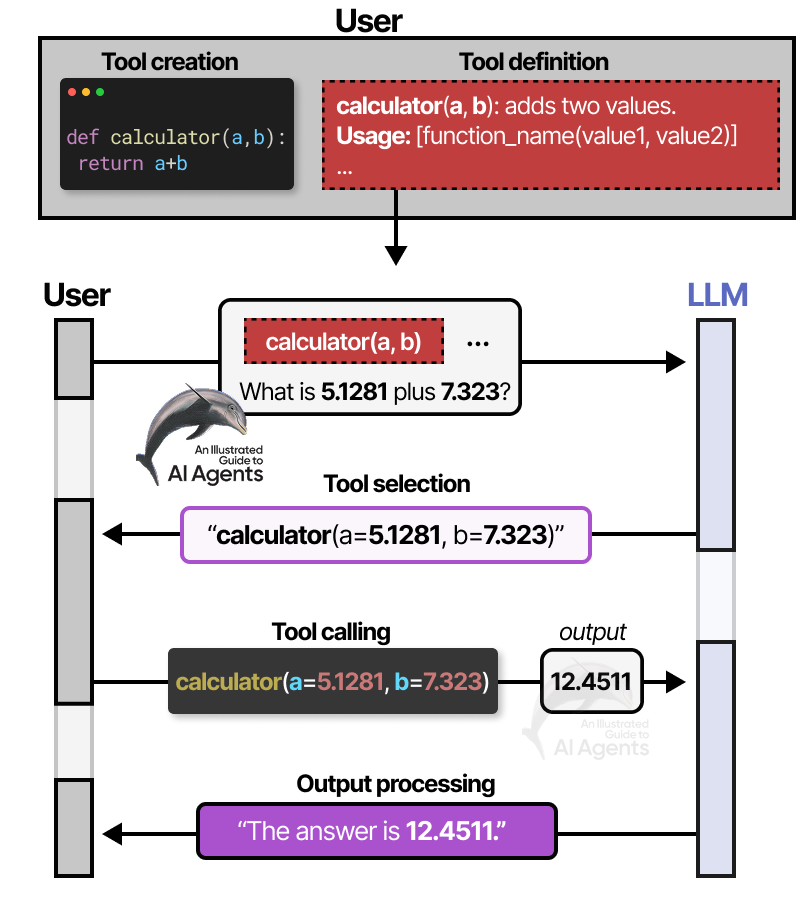
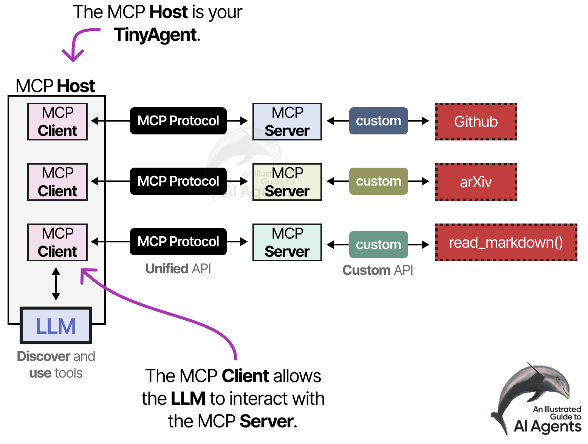

# Module 4 — Tools & MCP (Lecture Notes)
**Course:** 307307 BI Methods for Generative AI — *Agentic AI half* | **University of Petra**
**Reference:** Grootendorst & Alammar, *An Illustrated Guide to AI Agents* (O'Reilly, 2026), Chapter 5.

> So far our agent can think (Module 2) and remember (Module 3) — but it still can't *do* anything. This module gives it **tools**, so it can act on the world: use a calculator, search the web, read a file. In the lab you give the `TinyAgent` a tool and watch it actually call it.

*Adding Tools to the TinyAgent. An Illustrated Guide to AI Agents (O'Reilly, 2026).*

## Learning Objectives
By the end of this module you should be able to:
- Explain what a **tool** is and why an LLM needs one to *act*.
- Trace the **tool-calling flow**: create → define → select → call → process output.
- Explain **intent vs action** — and why executing the tool ourselves is a **safety boundary**.
- Describe how a tool is **defined** to the LLM (prompted vs native / schemas).
- Explain what **MCP** is and the problem it solves; recognise **Skills**.

## 1. What is a tool, and why?
A plain LLM is a text-in / text-out function. It can *describe* wanting to search the web or do a calculation, but it **cannot act**. A **tool** is simply a function or API we let the agent use — a calculator, a web search, a file reader, a database query. Tools fall into two kinds:
- **Take an action** (send an email, write a file), and
- **Retrieve information** (search, read a document, query an API).

Without tools, an agent can only think and plan — not act.

## 2. The tool-calling flow
Using a tool is more than "the LLM runs it." There are five steps:
1. **Create** the tool — write the function (well-documented; the docs are what the LLM reads).
2. **Define** it to the LLM — tell the model the tool exists, what it does, and how to call it.
3. **Select** — the LLM decides *which* tool (if any) fits the task (reasoning helps here).
4. **Call** — the LLM outputs a **tool call** (a structured string naming the tool and arguments).
5. **Process output** — *we* run the tool and feed the result back to the LLM.

*Figure 5-5 — the tool-calling flow. An Illustrated Guide to AI Agents (O'Reilly, 2026).*

## 3. Intent vs action — the safety boundary
This is the key idea. When the LLM "calls" a tool, it only **outputs text** expressing the *intent* — for example `{"tool": "multiply", "kwargs": {"a": "5.1", "b": "7.3"}}`. **Nothing happens** until *our* program reads that text, runs the real function, and returns the result.

That gap is a feature, not a bug:
- The model's request to act is **not** permission to act — our code decides whether to run it.
- We can require **human approval** for risky tools (delete a file, send a payment) before they run.

*Analogy:* the LLM is like an assistant who writes "please wire \$500 to this account" on a sticky note. Nothing moves until a person (your code) actually does it — and can refuse.

## 4. How the LLM is told about tools
- **Prompting (in-context)** — list the tools in the **system prompt** and tell the model the format to reply in (e.g. "reply with JSON `{\"tool\": ..., \"kwargs\": ...}`"). Simple and transparent; this is what we use in the lab. The small piece of code that reads the reply and extracts the call is called a **parser**.
- **Native / structured schemas** — newer models are trained to accept a formal **JSON schema** of each tool (name, description, parameters) and emit tool calls directly. Cleaner, more reliable, but more of a "black box."

Either way, the LLM must still *choose* and *format* the call correctly — which is why reasoning models are better at it.

**Good practice:** document tools well; keep the number of tools small (fewer than ~10 is a good start); keep each tool's scope narrow (few parameters).

## 5. The THOUGHT → ACTION → OBSERVATION loop
After the tool runs, we add its result back to the conversation (as an **OBSERVATION**) and let the LLM continue. You'll see these words in the lab: **THOUGHT** (what the model decides), **ACTION** (the tool call), **OBSERVATION** (the tool's result), **ANSWER** (the final reply). Looping over these is the **ReAct** pattern — the heart of the next module (Planning).

## 6. MCP — the Model Context Protocol
If every model talks to tools differently and every tool exposes itself differently, you get the **N × M problem**: N models × M tools = a custom integration for every pair. **MCP** (an open standard from Anthropic, late 2024) fixes this by standardising the connection — often called the **"USB-C port of AI."** With MCP it becomes **N + M** connections, and the *tool provider* maintains the integration, not you.

MCP has three parts:
- **Host** — the app using the LLM (for us, the TinyAgent; in practice Cursor, Claude, Copilot).
- **Client** — lives in the host; keeps a one-to-one connection to a server.
- **Server** — exposes a tool/data source (GitHub, arXiv, your files) via the standard.

*Figure 5-29 — the MCP host, client, and server. An Illustrated Guide to AI Agents (O'Reilly, 2026).*

There are MCP servers for GitHub, Home Assistant, and many more. A related standard, **A2A (Agent2Agent)**, standardises communication *between agents*.

## 7. Skills (briefly)
Tools tell an agent *what it can do*; **Skills** tell it *how to get a recurring job done* — a recipe of steps, conventions, and references for your specific context (also an Anthropic idea). Skills use **progressive disclosure**: only the name + description are always loaded; the full instructions load when the agent decides the skill is relevant; extra files load only when needed. This keeps the context window lean. *(This is exactly the mechanism behind the skills you may already use with Claude.)*

## 8. Common Misconceptions
- **"The LLM runs the tool."** No — it only emits the *intent*; our code runs it. (That's the safety boundary.)
- **"More tools = more capable."** Too many tools make selection harder and the context heavier. Keep the set small.
- **"MCP is an AI model / makes the model smarter."** No — MCP is a *connection standard*; the model still needs tool-calling ability.
- **"A tool call is guaranteed correct."** The model can pick the wrong tool or mis-format the call; validate and handle failures.

## 9. Summary
- A **tool** lets the agent *act*; without tools it can only think.
- Tool use has five steps: create, define, select, call, process output.
- The LLM only emits the **intent**; *we* execute — a built-in **safety boundary** (and where human-in-the-loop lives).
- Tools are defined by **prompting** or **native schemas**.
- **MCP** standardises tool connections (the "USB-C of AI"); **Skills** package procedural know-how.

## Review Questions
1. Why can't a plain LLM use a tool on its own? What does it actually produce?
2. List the five steps of the tool-calling flow.
3. Explain "intent vs action" and why it is a safety boundary. Where would human approval fit?
4. What problem does MCP solve, and what are its three components?
5. What is a Skill, and what does "progressive disclosure" mean?

---
*Figures in the slides are reproduced from Grootendorst & Alammar, An Illustrated Guide to AI Agents (O'Reilly, 2026), for internal University of Petra classroom use.*
