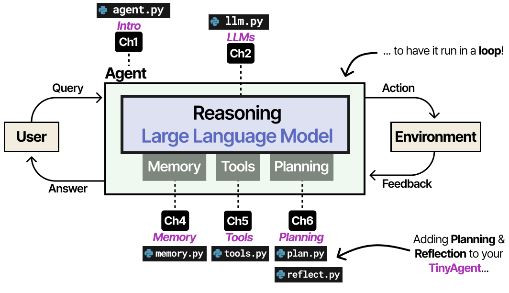
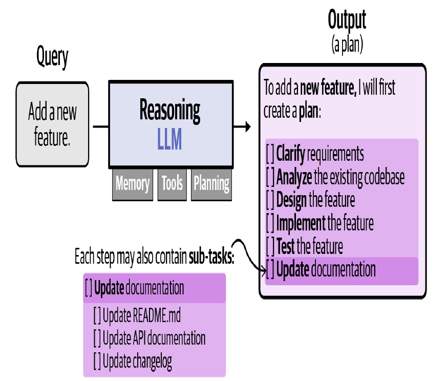
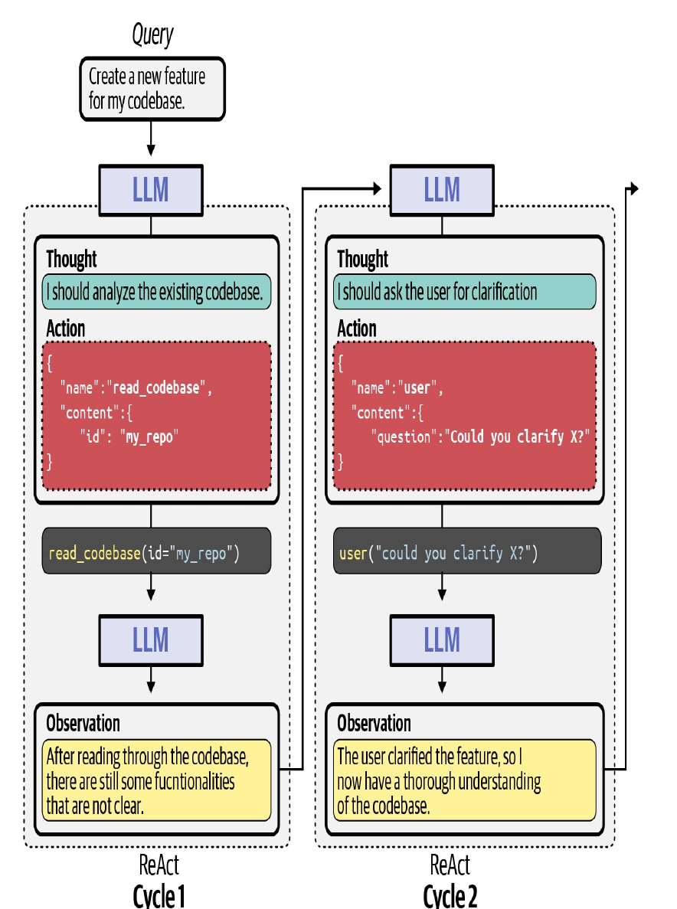

# Module 5 — Planning & Reflection (ReAct) (Lecture Notes)
**Course:** 307307 BI Methods for Generative AI — *Agentic AI half* | **University of Petra**
**Reference:** Grootendorst & Alammar, *An Illustrated Guide to AI Agents* (O'Reilly, 2026), Chapter 6.

> Our agent can think (M2), remember (M3), and act (M4) — but only **one step at a time**. This module adds the final ingredient: **planning** and the **ReAct loop**, which let the agent break a task into steps and work through them **on its own**. This is what finally makes it an *agent*. In the lab you watch it solve a multi-step problem autonomously.

*Adding Planning & Reflection to the TinyAgent — now it runs in a loop. An Illustrated Guide to AI Agents (O'Reilly, 2026).*

## Learning Objectives
By the end of this module you should be able to:
- Explain **task decomposition** — breaking a goal into smaller steps.
- Describe the **ReAct** loop: THOUGHT → ACTION → OBSERVATION, repeated until done.
- Explain what makes an agent **autonomous** (a loop + a stopping rule).
- Describe **reflection** (self-critique) and why it helps.
- Recognise what lies **beyond a single agent**: evaluation, multi-agent, multimodal, coding agents.

## 1. Planning — decompose the task
Real tasks take many steps. Ask an agent to "add a feature to my code" and it must clarify requirements, read the codebase, design, implement, test, and document. **Task decomposition** is breaking the big goal into these smaller, ordered sub-tasks so the agent knows what to do next — and can **revise the plan** as it learns more.

*Figure 6-2 — the LLM turns a query into a plan. An Illustrated Guide to AI Agents (O'Reilly, 2026).*

A reasoning LLM does this naturally (it "thinks step by step"). Prompting tricks like *"Let's think step by step"* (chain-of-thought) or *"make a plan, then solve it"* (plan-and-solve) encourage it.

## 2. ReAct — Reason + Act in a loop
Planning alone isn't enough: the agent must **act**, see what happened, and decide the next move. **ReAct** (Reason and Act) interleaves thinking and acting in a repeating cycle:

- **THOUGHT** — the agent reasons about what to do next.
- **ACTION** — it calls a tool (from Module 4).
- **OBSERVATION** — we run the tool and feed the result back.

…and it repeats, using each observation to decide the next thought — until it produces a final answer.

*Figure 6-13 — two ReAct cycles. An Illustrated Guide to AI Agents (O'Reilly, 2026).*

## 3. What makes it autonomous
The "magic" is surprisingly simple — **a loop**. The agent keeps running THOUGHT → ACTION → OBSERVATION until it decides to stop (by calling a special `final_answer`). Two safeguards matter:
- **A stopping rule** — the agent signals it's done with `final_answer`.
- **`max_steps`** — a cap on how many loops it may run, so a confused agent can't loop forever.

Put together, the four pieces from the whole course now form a real agent:
- **Reasoning LLM** (the brain) · **Memory** (so it remembers its steps) · **Tools** (so it can act) · **Planning / ReAct** (so it sequences actions autonomously).

*That is the complete single-agent foundation — everything since Module 1 has been building to this.*

## 4. Reflection — learning from its own mistakes
Agents can get stuck or go wrong. **Reflection** has the agent **critique its own work** and course-correct:
- **Self-Refine** — the same LLM drafts an answer, gives itself feedback, and refines it, in a loop (like a writer editing their own draft).
- **Reflexion** — a richer version with separate roles: one acts, one evaluates how well it did, one writes reflective feedback for the next attempt.

Reflection keeps an agent from getting stuck repeating the same mistake. (These are prompting techniques — straightforward to add.)

## 5. Beyond a single agent (course survey)
You've now built a complete **single** agent. The field goes further — here's the map of what comes next, at a glance:
- **Evaluation** — agents are hard to judge: look at the **outcome** (did the task get done?) *and* the **trajectory** (were the steps sound?), plus reliability and safety.
- **Multi-agent systems** — several specialised agents collaborate, often coordinated by a **supervisor** agent.
- **Multimodal agents** — agents that can also **see and hear** (images, audio, video), not just read text.
- **Coding agents** — agents that **run, test, and fix** real code in a dedicated environment (e.g. the assistants many developers now use).

These are surveyed briefly to show where the field is heading; the single-agent skills you built transfer directly.

## 6. Common Misconceptions
- **"ReAct is a special model."** No — it's a **loop + a prompt format**. Any capable LLM can do it.
- **"Planning means one fixed plan."** No — good agents **revise** the plan as they learn (reflection).
- **"An agent will always finish."** Not guaranteed — that's why we set **`max_steps`** and watch the trajectory.
- **"More steps = better."** Not necessarily; extra loops cost tokens and can wander. Stop when the goal is met.

## 7. Summary
- **Planning** decomposes a goal into ordered sub-tasks.
- **ReAct** loops THOUGHT → ACTION → OBSERVATION until a `final_answer`.
- A **loop + a stopping rule (`max_steps`)** is what makes the agent autonomous.
- **Reflection** lets an agent critique and improve its own work.
- Reasoning + Memory + Tools + Planning = a **complete single agent**. Beyond it: evaluation, multi-agent, multimodal, coding agents.

## Review Questions
1. What is task decomposition, and why does an agent need it?
2. Name the three parts of a ReAct cycle and what each does.
3. What two things make an agent autonomous — and what does `max_steps` protect against?
4. What is reflection? Briefly contrast Self-Refine and Reflexion.
5. Name the four components that together make a complete single agent.

---
*Figures in the slides are reproduced from Grootendorst & Alammar, An Illustrated Guide to AI Agents (O'Reilly, 2026), for internal University of Petra classroom use.*
