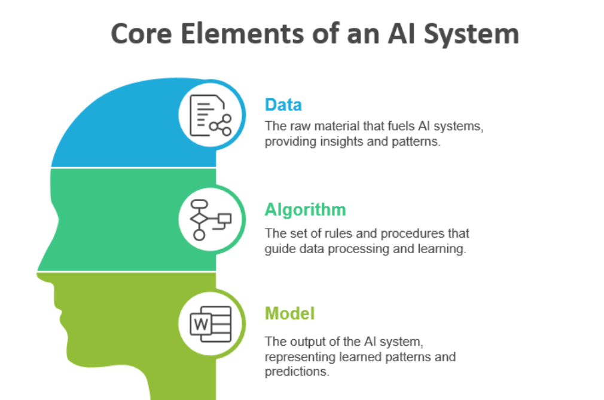
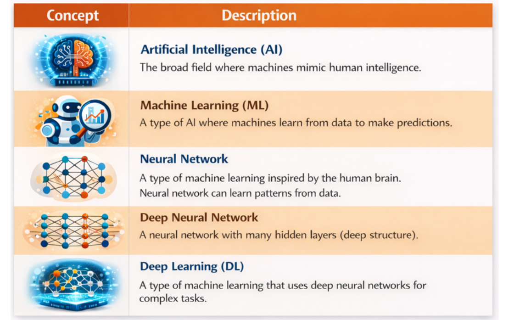
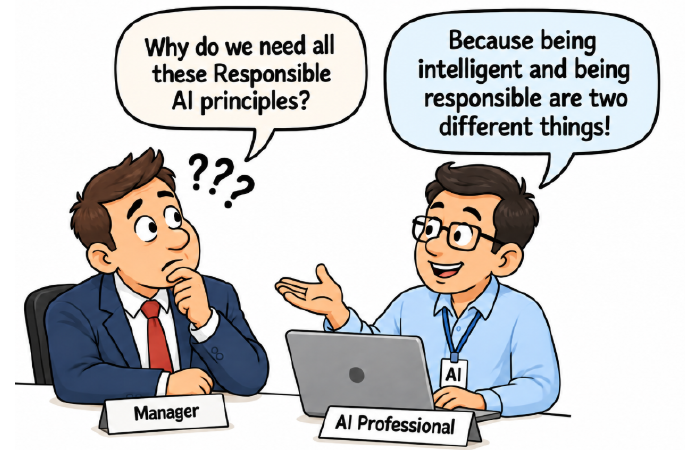

# Module 6 — Foundations of AI Governance (Lecture Notes)
**Course:** 307307 BI Methods for Generative AI — *AI Governance half* | **University of Petra**
**Reference:** Hemang Doshi, *AI Governance in Practice* (Packt, 2026), Chapters 1, 2 and 3.

> In the first half of the course we built agents. This module asks a different question: **who is in charge when AI makes decisions about people?** We start with how AI differs from normal software, then define **governance** (direction, control and accountability), see who does what, and meet the **twelve principles of Responsible AI**. In the activity you set up governance for one fictional system: a campus chatbot called Petra Study Buddy.

*Figure 1.1 — the core elements of an AI system. From AI Governance in Practice (Hemang Doshi, Packt, 2026).*

## Learning Objectives
By the end of this module you should be able to:
- Explain how **AI systems differ from normal software** and why that matters for control.
- Name the three building blocks of an AI system (**data, algorithm, model**) and the main **ways machines learn**.
- Describe what **AI governance** is, its **seven elements**, and how it differs from management, operations and IT governance.
- Say who does what: the board, the AI governance committee, owners, technical teams, risk, legal, security and audit.
- List the **twelve Responsible AI principles** and explain accountability in a simple case.

## 1. A story to start with
Imagine an email says your Citizen Credit Score has dropped. You may lose benefits and loans. You call, but the rules cannot be shared and there is no appeal. This story (fictional, from the book's opening) shows three failures: you **cannot see** how the score is worked out, **cannot understand** why it dropped, and **cannot challenge** the result. Governance is what prevents this.

## 2. AI versus normal software
| Aspect | Normal software | AI-based system |
|---|---|---|
| Decision logic | Fixed rules written by developers | Patterns learned from data |
| Learning | None | Learns and improves with more data |
| Behavior over time | The same | Can change |
| New situations | Needs a code change | Can adapt from training data |
| Transparency | Logic is usually easy to follow | Logic can be complex or opaque |
| Data | Limited use | Depends on large datasets |

*Based on Table 1.1 of the book.* Example: a fixed rule flags every email containing "Free" as spam, while an AI filter learns from what users move back to the inbox. With normal software you review the code once. With AI the code can stay the same while the outputs change, so outputs must be watched all the time.

## 3. Data, algorithm and model
- **Data** is the raw material the system learns from.
- **Algorithm** is the set of rules and procedures that guide the learning.
- **Model** is the result: the learned patterns used to make predictions.

A model is only as reliable as the data and algorithm behind it. **Risks start early**: gaps and bias in data, or poor design in the algorithm, end up as misleading or unfair decisions in the model.

## 4. How machines learn
- **Supervised learning**: learns from examples that already have the right answer (labels), such as emails marked spam or not spam.
- **Unsupervised learning**: finds hidden groups in unlabeled data, such as customer segments.
- **Semi-supervised learning**: a few labeled examples plus many unlabeled ones.
- **Reinforcement learning**: learns by trial and error with rewards and penalties.

*Figure 1.3 — how the terms fit together. From AI Governance in Practice (Hemang Doshi, Packt, 2026).*

**AI** is the goal; **machine learning** (ML) is one way to reach it, learning from data instead of hand-written rules. **Neural networks** are layers of connected "neurons" that find patterns; **deep learning** uses many layers for complex tasks such as images, speech and text.

## 5. Traditional ML versus LLMs, and where AI runs
- **Traditional ML models** serve one purpose (credit scoring, fraud detection). Governance focuses on data quality, validation, bias, explainability, performance, security and model changes.
- **Large language models (LLMs)** serve many purposes and add risks: **hallucinations, prompt attacks, data leakage, inappropriate outputs, misuse, copyright issues and third-party dependency**. You met several of these when building agents in the first half of the course.
- **Where it runs matters**: **cloud** (easy to scale, data sits with a provider), **on-premises** (more control, more effort), **edge** (on the device: fast, works offline).

## 6. What governance is: seven elements
AI governance is **direction, control and accountability** for AI. It says who is responsible for what, how decisions are made, and how actions are checked. The book lists seven elements:
1. **Governance committee**: a cross-functional group that guides key decisions.
2. **Roles and responsibilities**: owners for decisions, outcomes and risks, in writing.
3. **Policies and procedures**: the rules, and how to follow them.
4. **Decision-making structure**: how use cases are approved, escalated or rejected.
5. **Risk management**: find, assess and manage legal, ethical and operational risks.
6. **Compliance management**: follow laws, regulations, standards and internal rules.
7. **Audit**: independent assurance that the controls work.

## 7. Governance, management and operations
- **Governance** sets the rules and boundaries (the committee decides that high-risk decisions need human review).
- **Management** plans and organizes within them (writes the plan, assigns teams, sets deadlines).
- **Operations** does the daily work (configures and monitors the system, sends high-risk cases to reviewers).

Documents work in layers too: a **policy** says what we expect, a **procedure** says step by step how, and a **guideline** gives recommended practice with some flexibility. **Laws and regulations** come from outside; governance turns them into internal policies, procedures, roles and controls.

## 8. AI governance versus IT governance
| Aspect | IT governance | AI governance |
|---|---|---|
| Behavior | Stable and predictable once tested | Can change with retraining, drift or new settings |
| Focus | Availability, security, cost, business fit | Adds ethics, bias, transparency, explainability, accountability |
| Reach | Mainly the organization | Also individuals, customers and society |
| Extra tools | Change management, security controls | AI ethics policy, impact assessments, human oversight, model monitoring |

AI needs **stronger** governance because it learns and can change, its decisions can be hard to explain, and the rules about AI are changing fast. AI governance **builds on** IT governance and does not replace it.

## 9. Who does what
| Role | Typical responsibility |
|---|---|
| Board and senior management | Approve the framework, set the risk appetite |
| AI governance committee | Review and approve use cases, especially high-risk ones |
| Business and use-case owners | Define the purpose, own the impact of decisions |
| Data science and technical teams | Build, test, document and monitor systems |
| Risk management | Identify, assess and report AI risks |
| Legal and compliance | Keep systems within laws, regulations and contracts |
| Information security and privacy | Protect data, models and access |
| Internal audit | Independent assurance that governance works |

Without defined ownership, accountability gaps appear and risks go unmanaged.

## 10. Responsible AI: the twelve principles

*Figure 3.1 — intelligence is not enough. From AI Governance in Practice (Hemang Doshi, Packt, 2026).*

1. **Accountability** 2. **Fairness and non-discrimination** 3. **Transparency** 4. **Explainability** 5. **Privacy and data protection** 6. **Security and resilience** 7. **Safety and reliability** 8. **Human oversight** 9. **Risk-based approach** 10. **Ethical and responsible use** 11. **Continuous monitoring and improvement** 12. **Compliance with laws and standards**

There is no single global authority. The principles come from **laws** (such as the EU AI Act), **standards bodies** (ISO/IEC, NIST) and **industry or research groups**; the board adopts them and governance puts them to work.

## 11. Case: who is accountable?
Customers are repeatedly rejected for loans and one sues. **Company A** built a large language model (a general-purpose AI provider). **Company B** used it to build a loan-approval system (the provider of that system). **Company C**, a bank, uses the system on real customers (the deployer).
- A documents the model's limits and known risks; it is usually not directly responsible for loan decisions.
- B must meet the rules for high-risk systems (risk management, data governance, testing, documentation) and may share liability.
- C holds the **primary accountability**: human oversight, lawful use, monitoring outcomes, handling complaints.

*Illustrative reading of the book's case; not legal advice.* **Lesson:** agree on accountability **before** launch, through contracts, policies and risk assessments. Responsibility cannot be passed to the technology.

## 12. Measuring governance with KPIs
Governance is only real if it can be measured. Examples from Table 2.1 of the book: AI systems in the inventory ≥ 95%; use cases approved by the committee 100%; high-risk systems with a completed assessment 100%; reviews on time ≥ 90%; models monitored for bias and drift ≥ 95%; critical incidents 0; governance issues closed within 30 days; staff trained ≥ 90%. Each organization sets its own targets.

## 13. Common Misconceptions
- **"AI is just software, so IT governance is enough."** No — AI learns and changes, can be opaque, and affects people outside the organization.
- **"Governance is the same as management."** No — governance sets direction and boundaries; management plans within them; operations carry out the work.
- **"If the model is accurate, it is responsible."** Not necessarily (Figure 3.1): it can still be unfair, unexplainable or unsafe.
- **"Risks appear only when the model is deployed."** They begin early, in the data and the algorithm.
- **"If we buy the AI, the vendor is accountable."** Contracts can share liability, but the organization that deploys the system keeps primary accountability for how it is used.

## 14. Summary
- AI **learns from data** and its behavior can change, so it needs more than the controls used for fixed-rule software.
- Every AI system has **data, algorithm and model**; risks often start early.
- **Governance = direction, control, accountability**, built from seven elements: committee, roles, policies, decision-making, risk, compliance, audit.
- Governance sets the rules, management plans, operations do the work. AI governance **builds on** IT governance.
- **Responsible AI principles** guide the choices; **accountability** and **human oversight** must be clear before launch.

## Review Questions
1. Give three differences between AI-based and normal software.
2. What are the three building blocks of an AI system? Why do risks often start before the model exists?
3. Name two extra risks that LLMs add compared with traditional ML models.
4. List the seven elements of governance. Which element is independent of day-to-day running?
5. What is the difference between governance, management and operations? Give a campus example.
6. Give two reasons why AI governance needs more than IT governance.
7. Choose three of the twelve principles and describe one practice for each in a university chatbot.
8. In the loan case, why does Company C hold the primary accountability?

---
*Figures in these notes and slides are reproduced from Hemang Doshi, AI Governance in Practice (Packt, 2026), for internal University of Petra classroom use. The credit-score story and the Petra Study Buddy scenario are fictional.*
