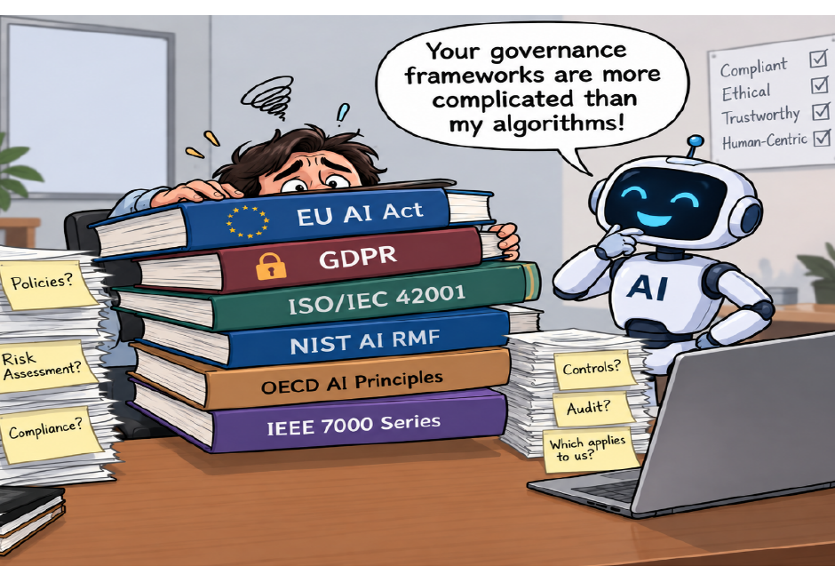
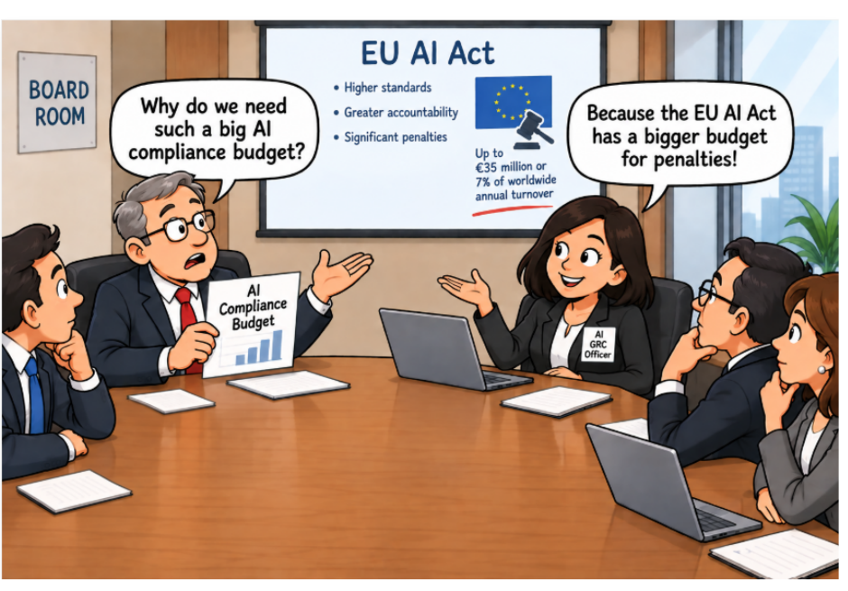

# Module 7 — The Rules Landscape: EU AI Act, NIST AI RMF and OECD (Lecture Notes)
**Course:** 307307 BI Methods for Generative AI — *AI Governance half* | **University of Petra**
**Reference:** Hemang Doshi, *AI Governance in Practice* (Packt, 2026), Chapters 4, 6, 7 and 8.

> Module 6 explained what governance is inside an organization. This module looks outside: **which laws, standards and frameworks must an organization deal with, and how binding are they?** We learn the three kinds of rules, study the **EU AI Act** (a law), the **NIST AI RMF** (a framework) and the **OECD AI Principles** (shared values), and see why a smart organization builds **one program that meets many rules**. ISO/IEC 42001 gets its own module next. In the activity you apply the rules to six fictional campus AI tools.

*Figure 4.1 — many rules at once. From AI Governance in Practice (Hemang Doshi, Packt, 2026).*

## Learning Objectives
By the end of this module you should be able to:
- Tell apart a **regulation**, a **standard** and a **framework**, and say which are legally binding.
- **Classify** an AI system under the EU AI Act's **four risk levels** and name the main duties of **providers and deployers**.
- Describe the **four functions** of the NIST AI RMF and how **profiles** support a gap analysis.
- Explain the **five OECD AI principles** and why governance programs share **common themes**.

## 1. Regulation, standard, framework
| Kind | Legally binding? | What it is | Example |
|---|---|---|---|
| **Regulation** | Yes | Rules issued by governments or regulators, with penalties | EU AI Act, GDPR |
| **Standard** | No, unless required | Documented requirements for consistent practice; certification possible | ISO/IEC 42001 |
| **Framework** | No, unless required | Structured guidance and good practice for one area | NIST AI RMF |

A standard or framework becomes mandatory when a law, a contract or a certification commitment requires it. Almost every country has AI rules or is writing them, and they all build on the Responsible AI principles from Module 6.

## 2. The landscape at a glance
| Name | Type | Issued by | Main focus |
|---|---|---|---|
| EU AI Act | Regulation | European Union | Risk-based AI law for providers and deployers |
| GDPR | Regulation | European Union | Privacy and data protection, including AI |
| US Executive Order on AI (2023) | Directive | US government | National AI safety direction to agencies |
| ISO/IEC 42001 | Standard | ISO and IEC | Management system for AI governance |
| NIST AI RMF | Framework | NIST (USA) | Risk-based management of AI risks |
| OECD AI Principles | Framework | OECD | High-level principles for trustworthy AI |
| IEEE 7000 series | Framework | IEEE | Ethical design of AI and autonomous systems |
| WEF AI Governance Playbooks | Framework | World Economic Forum | Board-level and industry good practice |

*Based on Table 4.1 of the book.* **Update:** the book lists the 2023 US executive order, but it was withdrawn in January 2025. US practice now relies on agency guidance and voluntary frameworks such as NIST.

**GDPR in one paragraph.** Because most AI systems use personal data, GDPR matters: organizations need a lawful basis, a clear purpose, only the data necessary, accurate data, retention limits, security, a data protection impact assessment for high-risk processing, and safeguards (information, human intervention, the right to contest) for solely automated decisions with significant effects.

## 3. The EU AI Act
The world's first comprehensive AI law. It is **legally binding** and **risk-based**.

**Who must comply?** Anyone whose AI system is placed on the EU market, put into service in the EU, or produces outputs that affect people in the EU, wherever the organization is based.

**What is an AI system?** A machine-based system with some autonomy that infers from data how to produce predictions, recommendations or decisions. Fixed-rule software without learning or inference is generally not covered.

**Roles.** The duties you carry depend on your role:
- **Provider**: develops an AI system or puts it on the market under its own name.
- **Deployer**: uses an AI system in its own operations.
- **Importer**: brings a non-EU provider's system onto the EU market.
- **Distributor**: makes a system available without changing it.

Example from the book: a company that builds an employment-screening system is the provider; the organization that uses it to screen applicants is the deployer. This is the same logic as the A, B, C case in Module 6.

### Four risk levels
| Level | Rule | Examples |
|---|---|---|
| **Prohibited** (unacceptable risk) | Banned | Social scoring, manipulative AI, real-time biometric surveillance in public (limited exceptions), emotion recognition at work or school |
| **High** | Allowed only with strict requirements | Recruitment, credit scoring and loans, medical devices, exam and student assessment, critical infrastructure |
| **Limited** (transparency risk) | Tell people it is AI | Chatbots, AI-generated images, audio and video |
| **Minimal** | No special legal duties | Spam filters, video games, movie and music recommendations |

*Based on Tables 8.1 and 8.2 of the book.* **The category depends on the purpose and context, not only on the technology.** Facial recognition used to unlock an office door has limited rules; the same technology used for real-time identification in public spaces is prohibited. Always get legal advice for the final classification.

### Classify it in four steps
1. **Define the purpose**: what is the system for, and how are its outputs used?
2. **Prohibited?** If yes, it cannot be used.
3. **In a high-risk area?** Recruitment, credit, health, education, biometrics, essential services. If yes, strict rules apply.
4. **A transparency duty?** Chatbot or AI-generated content: limited risk. Otherwise: minimal risk.

Write down your reasoning, and **reassess** when a feature or the purpose changes. (The book's example: a bank assistant that gives general information later gains a creditworthiness feature and becomes high risk.)

### What high-risk providers must do
Risk management system (Art. 9) · data governance (Art. 10) · technical documentation (Art. 11) · automatic record-keeping (Art. 12) · information for deployers (Art. 13) · human oversight (Art. 14) · accuracy, robustness and cybersecurity (Art. 15) · conformity assessment and CE marking, post-market monitoring and serious-incident reporting. **Deployers** must use the system as instructed, keep human oversight, monitor it, and make sure its use is not unlawful or discriminatory.

*Image 8.1 — penalties make compliance a board-level topic. From AI Governance in Practice (Hemang Doshi, Packt, 2026).*

### Penalties and enforcement
| Violation | Maximum fine (whichever is higher) |
|---|---|
| Prohibited AI practices | €35 million or 7% of worldwide annual turnover |
| High-risk obligations not met | €15 million or 3% of worldwide annual turnover |
| Misleading information to authorities | €7.5 million or 1.5% of annual turnover |

*Table 8.3 of the book.* National authorities can investigate, audit, order corrective action, and restrict or withdraw systems, in a proportionate, risk-based way. Anyone can complain to their national market surveillance authority. *Check the official EU page for the Act's application dates, which are phased in.*

## 4. The NIST AI Risk Management Framework
NIST is a US government standards agency, **not a regulator**. Its AI RMF is **voluntary, flexible and technology-neutral**, yet widely used. It rests on **seven traits of trustworthy AI**: valid and reliable, safe, secure and resilient, accountable and transparent, explainable and interpretable, privacy-enhanced, and fair with harmful bias managed.

It is organized as **Functions → Categories → Subcategories** (4 functions, 19 categories, 72 subcategories):
| Function | Categories | Subcategories | Purpose |
|---|---|---|---|
| **Govern** | 6 | 19 | Policies, roles, accountability, culture, stakeholder and third-party processes |
| **Map** | 5 | 18 | Understand context, purpose, stakeholders, risks, benefits and impacts |
| **Measure** | 4 | 22 | Measure and monitor risks, performance and trustworthiness |
| **Manage** | 4 | 13 | Prioritize and treat risks; respond, recover and improve |

*Table 6.1 of the book.* You do **not** have to apply every subcategory: an organization that only buys third-party AI may skip those about building its own models.

**Putting it to work.**
- **Profiles**: a *current profile* says what you do now, a *target profile* says what you want. The difference is your gap and your to-do list. (Example: for GOVERN 1.1, current "AI laws are identified but not documented or reviewed", target "documented, assigned to owners and reviewed periodically".)
- **Playbook**: practical suggestions for each subcategory.
- **Crosswalks**: show how the AI RMF lines up with other frameworks such as ISO/IEC 27001, so you do not repeat work.
- Treat the checklist as an **implementation tool, not a tick-box list**: pick relevant subcategories, assess current state, find gaps, assign owners, keep evidence, review again.

## 5. The OECD AI Principles
The OECD has 38 member countries. Its AI Principles (adopted 2019, the first intergovernmental AI standard; updated May 2024 for generative AI, safety, information integrity, privacy, copyright and sustainability) are **not legally binding** but have shaped the EU AI Act and ISO/IEC 42001. They are technology-neutral and apply to developers, deployers and buyers across the lifecycle.
1. **Inclusive growth, sustainable development and well-being**: benefit people and the planet, including AI's energy use.
2. **Respect for the rule of law, human rights and democratic values, including fairness and privacy.**
3. **Transparency and explainability**: people know when AI is used and can understand outcomes.
4. **Robustness, security and safety** throughout the lifecycle.
5. **Accountability**: clear roles for who answers for the system.

Practice examples: assess social impact before approving a hiring tool; test for bias across groups; disclose chatbot use; test regularly and monitor for drift; name an owner for each AI system and give people a way to appeal.

## 6. One program, many rules
| OECD principle | ISO/IEC 42001 | NIST AI RMF |
|---|---|---|
| Inclusive growth and well-being | AI policy, objectives, risk assessment, continual improvement | Govern and Map: impacts, benefits and costs |
| Human rights and fairness | Data governance, human oversight, bias controls | Map, Measure (bias), Manage |
| Transparency and explainability | Documentation, communication, disclosure | Map, Measure (explainability), Manage |
| Robustness, security and safety | Lifecycle controls, monitoring, incident management | Measure and Manage |
| Accountability | Leadership, roles, governance structures, audits | Central to Govern |

*Based on Table 7.1 of the book.* The book's Table 4.2 compares six sources (OECD, ISO/IEC 42001, NIST AI RMF, EU AI Act, WEF, IEEE) against the twelve Responsible AI principles. Accountability, fairness, transparency, explainability, security, safety, human oversight and compliance appear in all six. **Practical lesson:** do not build six programs. Find the common requirements, build shared controls once, then add the extras that a specific law demands.

## 7. Common Misconceptions
- **"All AI rules are laws."** No. Only regulations bind. Standards and frameworks are voluntary unless a law or contract requires them.
- **"The EU AI Act only applies to European companies."** No. It follows the system and its effects on people in the EU.
- **"Risk level depends on the technology."** No. It depends on the purpose and context (facial recognition example).
- **"A system keeps the same risk level for life."** No. Reassess when features or purpose change.
- **"We bought the tool, so the vendor carries all duties."** No. The provider and the deployer each have duties.
- **"The NIST AI RMF is a checklist to complete."** No. Use the relevant subcategories to find and close gaps, and keep evidence.

## 8. Summary
- Regulations bind; standards and frameworks guide, unless required by law or contract.
- The **EU AI Act** is risk-based (prohibited, high, limited, minimal). Purpose and context set the level; your **role** sets your duties; fines can reach 7% of turnover.
- The **NIST AI RMF** organizes AI risk work into **Govern, Map, Measure, Manage**, and **profiles** show the gap between now and target.
- The **OECD principles** give five shared values that other rules build on.
- Rules overlap heavily, so build **one program** with shared controls.

## Review Questions
1. What is the difference between a regulation, a standard and a framework? Give one example of each.
2. Name the four EU AI Act risk levels and one example for each.
3. Why can the same technology (for example facial recognition) fall into different risk levels?
4. What is the difference between a provider and a deployer? Give an example of a duty for each.
5. List the four NIST AI RMF functions and say in one sentence what each does.
6. What are a current profile and a target profile, and how do they help?
7. List the five OECD AI principles. Which one do you think is hardest to apply, and why?
8. Why should an organization look for common themes across AI rules instead of building a separate program for each?

---
*Figures in these notes and slides are reproduced from Hemang Doshi, AI Governance in Practice (Packt, 2026), for internal University of Petra classroom use. The campus scenario in the activity is fictional. This module gives practical guidance, not legal advice.*
