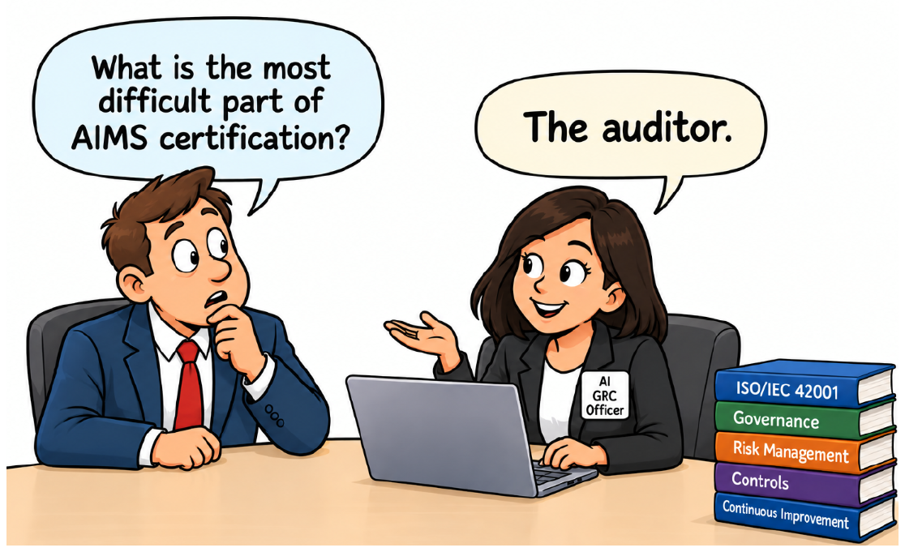
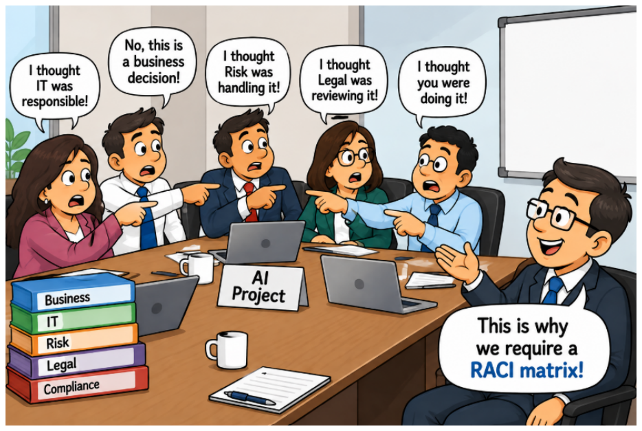
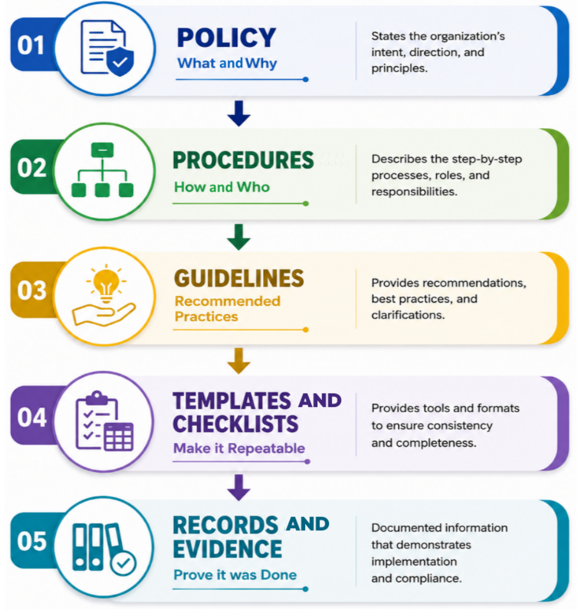

# Module 8 — ISO/IEC 42001 and Governance Structure (Lecture Notes)
**Course:** 307307 BI Methods for Generative AI — *AI Governance half* | **University of Petra**
**Reference:** Hemang Doshi, *AI Governance in Practice* (Packt, 2026), Chapters 5, 11, 12 and 13.

> Module 7 looked at the rules outside the organization. This module is about building governance **inside** it. We study the standard for an **AI management system (ISO/IEC 42001)**, learn how to **choose among frameworks**, see **who owns what** in a governance structure, and list the **documents** that turn policy into evidence. In the activity you set up AI governance for the fictional University of Petra.

*Figure 5.1 — certification means proving it works. From AI Governance in Practice (Hemang Doshi, Packt, 2026).*

## Learning Objectives
By the end of this module you should be able to:
- Describe the structure of **ISO/IEC 42001**: clauses 4–10, Annex A controls and the **Statement of Applicability (SoA)**.
- Explain the **road to certification** and what **auditors look for**.
- **Choose** between the OECD principles, the NIST AI RMF and ISO/IEC 42001 for a given situation.
- Assign governance roles with a **RACI matrix** and name the **documents** a governance program needs.

## 1. ISO/IEC 42001 at a glance
- It is the **first international management-system standard for AI** (2023). It sets requirements for an **AI Management System (AIMS)**: the policies, processes, roles, responsibilities and controls used to manage AI in a structured way.
- It is published by **ISO** (International Organization for Standardization, members in 160+ countries) and **IEC** (International Electrotechnical Commission). Standards are drafted by expert working groups, reviewed by member countries and approved by a two-thirds vote.
- It uses the **same management-system structure as ISO/IEC 27001** (information security), so it fits with existing security, privacy and risk programs.
- Organizations can be **certified** by an accredited certification body. Certification covers the standard **as a whole**; there is no partial certification.

## 2. Ten clauses
| Clause | Title | In plain words |
|---|---|---|
| 1–3 | Scope, normative references, terms | Informational, not audited |
| 4 | Context of the organization | Understand internal and external factors; define the AIMS scope |
| 5 | Leadership | Top management commitment, AI policy, roles and accountability |
| 6 | Planning | AI risk assessment, risk treatment, objectives |
| 7 | Support | Resources, competence, awareness, communication, documents |
| 8 | Operation | Operational controls across the AI lifecycle |
| 9 | Performance evaluation | Monitoring, measurement, internal audit, management review |
| 10 | Improvement | Corrective action and continual improvement |

*Based on Table 5.1 of the book.* **Clauses 4–10 are mandatory** for certification.

## 3. Annex A and the Statement of Applicability
There are four annexes: **A** reference AI controls, **B** implementation guidance, **C** mapping to other standards (such as ISO/IEC 27001), **D** sector and use-case considerations.

**Annex A control areas:** governance and accountability · AI risk management · data governance · AI lifecycle management · transparency and explainability · human oversight and intervention · security and resilience · monitoring, logging and performance evaluation · incident management and corrective action · third-party AI management.

The **Statement of Applicability (SoA)** lists, for every Annex A control, whether it is **applicable**, **why**, and **how it is implemented**. Exclusions must be justified. Auditors use it as key evidence that risks were assessed systematically.

*Campus example (invented):* Human oversight — applies, because admissions decisions affect people and a person reviews every decline. Third-party AI — applies, because the chatbot is bought and the vendor is assessed before contract. Model training — not applicable, because the university buys models and trains none (reason recorded).

## 4. The road to certification
1. **Write an AI governance policy** aligned with the standard.
2. **Run a gap assessment** against the requirements and assign fixes.
3. **Prepare the SoA.**
4. **Implement and keep evidence**: risk and impact assessments, data checks, bias tests, documentation, human review, monitoring.
5. **Certification audit** by an accredited body.

The book's case: a lender using AI for loans found no AI-specific impact assessment, an incomplete inventory, weak data quality and bias checks, limited explainability, and no defined human oversight or monitoring, and assigned each gap to an owner.

## 5. What auditors look for
The auditor does not only check that documents exist. They want **objective evidence** that the system is established, followed, monitored and improved, and may interview staff.
- **AI inventory**: systems in scope, purpose, owner, data, risk class, status.
- **Risk assessment and treatment**: risks found, plans made, owners assigned, controls implemented.
- **Roles and responsibilities**: assigned, understood, with authority and resources.
- **Controls in operation**: data, oversight, transparency, security, lifecycle, monitoring, third parties.
- **Policies and procedures**: approved, communicated, followed.
- **Monitoring and measurement**: results, risk indicators, incident records.
- **Incidents and corrective action**: recorded, investigated, fixed, re-checked.
- **Internal audit and management review**: done on a schedule, with follow-up.
- **Training, documented information and continual improvement.**

A well-written policy that is not followed leads to **findings (nonconformities)**.

## 6. Common pitfalls
IT-only ownership · chasing the certificate · policies on paper · incomplete inventory · SoA as a formality · weak management support · ignoring third-party AI · treating it as a one-time project. *(Chapter 5.)* The goal is governance that keeps working after the audit.

## 7. Choosing a framework
| Our situation | Good starting point | Why |
|---|---|---|
| Just starting with AI; no AI law applies yet | OECD AI Principles | Direction without heavy process |
| Ready for detailed policies but want flexibility | NIST AI RMF | Four functions; you choose how to apply them |
| Need a formal, organization-wide, auditable system, maybe certification | ISO/IEC 42001 | Management system with roles, controls and audit |
| Serve people in the EU | EU AI Act | It is law: first check whether it applies |

*Based on Chapter 11.* The instruments are **complementary**: OECD says what good looks like, NIST says which risk activities to run, ISO says how to build them into the organization, and the law says what you must do. The book argues ISO has a practical advantage because it is a management system, is implementation-oriented, supports audit evidence, gives enterprise-wide consistency and fits lifecycle thinking. In its mapping tables, the OECD principles and NIST's Govern, Map, Measure and Manage correspond to ISO clauses and Annex A controls, so a well-run ISO system covers much of both. *Counter-view for discussion:* a small organization may find a full management system too heavy, and may start with NIST or the OECD principles.

## 8. Build on ISO/IEC 27001
If you already have an information security management system, you can reuse much of it, though 42001 is not only an extension (security and responsible AI have different goals):
1. **Review the scope** (it need not be identical).
2. **Align risk management**: add AI risk criteria (fairness, transparency, safety, oversight) to the existing method and register.
3. **Align the committee**: widen the existing IT or security committee to include AI.
4. **Align management review.**
5. **Align internal audit**, adding AI expertise where needed.

## 9. Governance structure

*Figure 12.1 — role clarity. From AI Governance in Practice (Hemang Doshi, Packt, 2026).*

A structure answers **four questions**: who **owns** the AI system, who **approves** its use, who **monitors** its behavior, and who is **accountable** when something goes wrong. It should build on existing governance and risk arrangements.

| Role | Main job |
|---|---|
| Board and senior management | Set direction, approve policy, define risk appetite |
| AI governance committee | Review high-risk use cases and significant risks (may be an existing committee) |
| **AI GRC officer** | Coordinates governance: policies, inventory, risk register, regulation tracking. **Not** the owner of every system |
| **AI system owner** | Accountable for one system's purpose, risks and lifecycle |
| Business and AI development teams | Build and run systems; control data, bias and performance |
| IT and information security | Secure environment, access, logging, incident response |
| Risk and compliance | Second-line oversight; review high-risk use cases |
| Legal and privacy | Laws, contracts, data protection, intellectual property |
| Internal audit | Independent assurance; never runs AI systems |

### RACI matrix
**R**esponsible (does the work) · **A**ccountable (owns the outcome; one per activity) · **C**onsulted · **I**nformed. Selected rows of Table 12.1:

| Activity | Board | AI cttee | GRC officer | System owner | Dev team | Risk/ compl. | Legal/ privacy | Security | Audit |
|---|---|---|---|---|---|---|---|---|---|
| Approve AI governance policy | A | R | C | I | I | C | C | C | I |
| Maintain AI inventory | I | I | R | A | C | C | I | C | I |
| Conduct AI risk assessment | I | C | R | A | C | C | C | C | I |
| Regulatory and legal assessment | I | C | R | C | I | C | A/R | I | I |
| Approve high-risk AI system | A | R | C | C | C | C | C | C | I |
| Monitor AI system | I | C | C | A | R | C | C | R | I |
| Manage AI incidents | I | C | R | A | R | C | C | R | I |
| Independent governance audit | I | I | C | C | I | C | C | C | A/R |

Disagreements (for example between the business owner and Legal) are escalated to the committee or senior management. Customize the matrix: not every organization has all these roles.

**Typical pitfalls:** a separate structure when an existing committee could do it · no named owner per system · the GRC officer becoming the owner of everything · a committee with no real authority · no escalation path · governance as a one-time activity · weak evidence · no independent assurance.

## 10. Governance documents

*Figure 13.2 — from intent to evidence. From AI Governance in Practice (Hemang Doshi, Packt, 2026).*

**Policy** (what and why) → **Procedures** (how and who) → **Guidelines** (recommended practice) → **Templates and checklists** (make it repeatable) → **Records and evidence** (prove it was done).

Documents a program typically needs: AI governance policy · use-case assessment and approval form · AI system inventory · impact assessment · risk assessment and risk register · vendor and third-party assessment · model and system documentation · monitoring and review records · incident procedure and records · change management records · committee records · training records · governance review and audit records.

Example of change management: a loan model that only recommended now decides loans automatically. That is a significant change, so it needs a new risk and impact assessment and approval.

### What an AI governance policy contains
Purpose and objectives · scope and applicability · governance principles · roles and responsibilities · AI risk management · AI use-case governance · data governance for AI · model and system governance · human oversight and accountability · third-party and vendor governance · security and resilience · compliance and legal alignment · incident management and response · documentation and record keeping · training and awareness · monitoring, review and continuous improvement · exceptions and non-compliance · policy approval, review and maintenance. *(Figure 13.3.)* The policy should cover built, bought and third-party AI, including generative AI tools.

## 11. Common Misconceptions
- **"Certification means we have a policy."** No. Auditors want evidence that controls run in practice.
- **"AI governance is an IT job."** No. It needs business, legal, risk, privacy, security and leadership.
- **"The AI GRC officer owns every AI system."** No. The officer coordinates; owners are accountable.
- **"We must build a brand-new committee."** Not necessarily. An existing risk, technology or compliance committee can take it on.
- **"The SoA is a form to fill in."** No. It records which controls apply to real risks, with reasons.
- **"One person can both run and audit the system."** No. Audit must be independent.

## 12. Summary
- **ISO/IEC 42001** is a certifiable management-system standard for AI: clauses 4–10, Annex A controls and the SoA.
- Certification needs **evidence** that governance works in practice.
- OECD, NIST AI RMF, ISO/IEC 42001 and the law are **complementary**; first ask which laws apply.
- A governance structure answers **who owns, approves, monitors and is accountable**; a **RACI matrix** makes it clear.
- A **hierarchy of documents** turns policy into evidence; build on existing GRC systems.

## Review Questions
1. What is an AI Management System, and why is ISO/IEC 42001 called a management-system standard?
2. Which clauses are mandatory for certification? Name three of them and their purpose.
3. What is a Statement of Applicability and why do auditors value it?
4. List the steps on the road to certification. Why is a gap assessment useful?
5. Give four kinds of evidence an auditor may ask for.
6. In which situations would you start with the OECD principles, the NIST AI RMF or ISO/IEC 42001?
7. What do R, A, C and I stand for? Why should each activity have only one A?
8. Why is the AI GRC officer not the owner of every AI system?
9. Name the five levels of the document hierarchy and give one example of each.

---
*Figures in these notes and slides are reproduced from Hemang Doshi, AI Governance in Practice (Packt, 2026), for internal University of Petra classroom use. The University of Petra scenario in the activity is fictional.*
