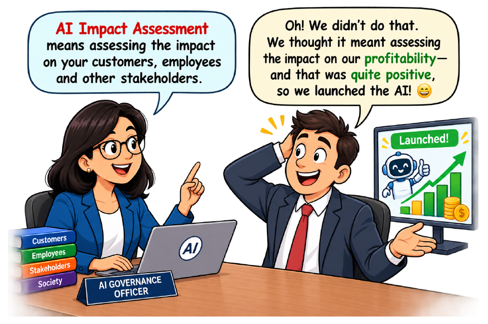
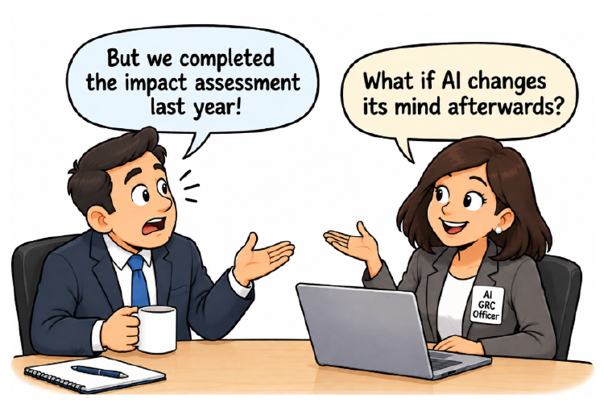
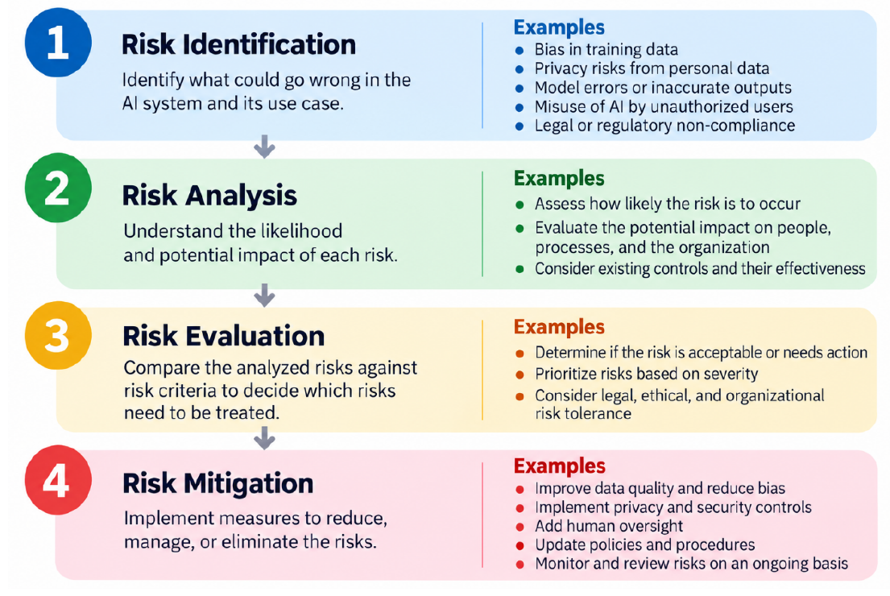

# Module 9 — AI Impact & Risk Assessment (Lecture Notes)
**Course:** 307307 BI Methods for Generative AI — *AI Governance half* | **University of Petra**
**Reference:** Hemang Doshi, *AI Governance in Practice* (Packt, 2026), Chapters 9 and 10.

> In the first half of the course we built agents that can think, remember and act. This module asks a different question: **who could be harmed when an AI system gets things wrong, and how should an organization decide what to do about it?** We answer it in two connected steps: an **AI impact assessment** (who is affected, and how?) and an **AI risk assessment** (how likely, how serious, and what will we do?). In the activity you apply both to one fictional case: a scholarship-screening tool.

*Figure 9.1 — impact means impact on people, not only on profit. From AI Governance in Practice (Hemang Doshi, Packt, 2026).*

## Learning Objectives
By the end of this module you should be able to:
- Explain what an **AI impact assessment (AIIA)** is and why standards and laws ask for one.
- Describe the **seven steps** of an AIIA and the main **areas of impact**.
- Name the main **types of AI risk** and the **four steps** of a risk assessment.
- Score a risk using **likelihood × impact** and read off its level.
- Choose a **treatment** (avoid, reduce, transfer, accept) and record it in a **risk register**.

## 1. Impact first, then risk
An **AI impact assessment** studies how an AI system could affect people, society and the organization, **before and after** launch. It is wider than "will the system fail?": it also asks how decisions made by the system affect fairness, transparency and trust.

An **AI risk assessment** takes those impacts and makes them measurable: how likely is each problem, how serious would it be, and what should we do about it?

Different frameworks use different words (ISO/IEC 42001, the EU AI Act for high-risk systems, the NIST AI RMF, and GDPR data protection impact assessments), but they agree on the basics: find harm early, focus on the people affected, match the effort to the level of risk, write things down, and keep reviewing.

## 2. Eight areas of impact
A good assessment looks beyond technical performance. The book lists these areas (our scholarship-tool examples in brackets):
1. **Individuals and fundamental rights** — unfair treatment, privacy, ability to challenge a decision. *(A transfer student is rejected with no appeal.)*
2. **Ethics and society** — trust, exclusion, over-reliance on automation.
3. **Legal and regulatory** — data protection, equal treatment, contracts.
4. **Technical and operations** — accuracy, reliability, explainability, known limits.
5. **Safety and security** — misuse, tampering, unauthorized access. *(Forged documents.)*
6. **Organization and business** — reputation, cost, changing staff roles.
7. **Environment** — energy and resources used to build and run the system.
8. **Third parties and stakeholders** — vendors, cloud hosts, partners. *(Who is responsible if the vendor's model is wrong?)*

Not every area matters equally for every system. The depth of the assessment should fit the system's purpose, risk and context.

## 3. Seven steps of an AIIA
1. **Understand the system** — what it does, who uses it, what data it needs, who is affected.
2. **Identify impacts and risks** — fairness, privacy, legal, safety, security, reputation.
3. **Assess severity and likelihood** — which problems are serious, and which are probable?
4. **Decide controls** — human review, bias testing, security measures, monitoring.
5. **Document** — impacts, controls, owners and decisions.
6. **Get approval** — from people such as risk, legal, security and the AI governance committee.
7. **Monitor and review** — reassess when the system, its data, its purpose or the rules change.

*Easy way to remember:* steps 1–3 **understand**, steps 4–5 **respond**, steps 6–7 **govern**.

*Figure 9.2 — an assessment is not a one-time activity. From AI Governance in Practice (Hemang Doshi, Packt, 2026).*

## 4. Types of AI risk
| Type | What goes wrong | Scholarship-tool example |
|---|---|---|
| Technical | Wrong or worsening outputs | Poor ranking of unusual transcripts |
| Ethical | Unfair or biased outcomes | The tool repeats bias found in past decisions |
| Legal and regulatory | Laws or contracts broken | Mishandled applicant data |
| Security | Attacks on data or model | Forged documents fool the screener |
| Operational | Poor use or oversight | The committee stops checking the ranking |
| Reputational | Loss of public trust | A news story about an unfair algorithm |

One situation can involve several types, and reputational risk often amplifies the others.

## 5. The four steps of risk assessment

*Figure 10.1 — risk assessment steps. From AI Governance in Practice (Hemang Doshi, Packt, 2026).*

- **Identify** what could go wrong. Useful techniques: expert workshops, risk checklists, learning from past incidents, stakeholder impact analysis, technical review, model documentation review, and checking every lifecycle stage. (Try the free *AI Incident Database*, incidentdatabase.ai, and the *MIT AI Risk Repository*, airisk.mit.edu/risks, both cited in the book.)
- **Analyse** how likely each risk is and how serious it would be.
- **Evaluate** the result against the organization's risk criteria: is it acceptable, or does it need action?
- **Treat** (mitigate) the risks that need it.

## 6. Scoring a risk
Rate **likelihood** and **impact** from 1 (Low) to 3 (High) and multiply:

| Impact ↓ / Likelihood → | Low (1) | Medium (2) | High (3) |
|---|---|---|---|
| **High (3)** | 3 | 6 | 9 |
| **Medium (2)** | 2 | 4 | 6 |
| **Low (1)** | 1 | 2 | 3 |

| Score | Level | What it means |
|---|---|---|
| 0–3 | Low | Standard controls and routine monitoring |
| 4–6 | Medium | Needs attention, defined controls and periodic review |
| Above 6 | High | Immediate action, strong controls, senior management oversight |

*Scoring scheme as in Tables 10.1 and 10.2 of the book. Each organization defines its own scales.* Worked example: a biased ranking with impact 3 and likelihood 3 scores 9, so it is **High**.

## 7. Treating risks and recording them
For each risk the organization chooses one of four responses:
- **Avoid** — do not proceed, or drop the risky feature (for example, no automatic rejection emails).
- **Reduce** — add controls that lower the likelihood or the impact (bias testing, human review, monitoring).
- **Transfer** — share the risk by contract or insurance. The organization **stays accountable** for the outcome.
- **Accept** — keep a small risk, with formal approval, and keep watching it.

The goal is that the **residual risk** (what is left over) fits the organization's **risk appetite**.

All of this goes into a **risk register**: a living table with, for each risk, an ID, a description, its cause, likelihood and impact, level, treatment, controls, an owner and a review status. Ideally AI risks sit in the organization's main (enterprise) register rather than a separate one.

## 8. Common Misconceptions
- **"Impact assessment means checking profit and performance."** No — it means checking the effect on **people**, society and the organization (Figure 9.1).
- **"We did it once, so we are covered."** No — reassess when the system, data, purpose or rules change (Figure 9.2).
- **"A high-accuracy model is a low-risk model."** Not necessarily: it may fail badly for a small group, or be misused, leaked or over-trusted.
- **"Buying from a vendor transfers the risk."** Contracts can share some risk, but the organization stays accountable for outcomes.
- **"The scoring formula gives the objective truth."** The numbers come from human judgement and agreed scales. They help us compare and discuss risks; they do not replace that discussion.

## 9. Summary
- An **AI impact assessment** asks who is affected and how, before and after launch, across **eight areas** and **seven steps**.
- A **risk assessment** has four steps: **identify, analyse, evaluate, treat**.
- **Score = likelihood × impact**; the level (Low, Medium, High) sets how strongly we act.
- Treat each risk by **avoiding, reducing, transferring or accepting** it, and record it in a **risk register** with a named owner.
- Both assessments are **living documents**, reviewed whenever things change.

## Review Questions
1. What is the difference between an AI impact assessment and an AI risk assessment?
2. Name four of the eight areas of impact and give one example for each.
3. List the seven steps of an AIIA. Which steps are about *governing* rather than understanding?
4. Name the six types of AI risk. Which one often makes the others worse?
5. A risk has impact High (3) and likelihood Medium (2). What is its score and level using the scheme in this module? Do you think that level is right for a risk to people's rights? Why or why not?
6. What are the four ways to treat a risk? Why does transferring a risk not remove responsibility?
7. Why should every risk in a register have a named owner?

---
*Figures in these notes and slides are reproduced from Hemang Doshi, AI Governance in Practice (Packt, 2026), for internal University of Petra classroom use. The scholarship-screener scenario is fictional.*
